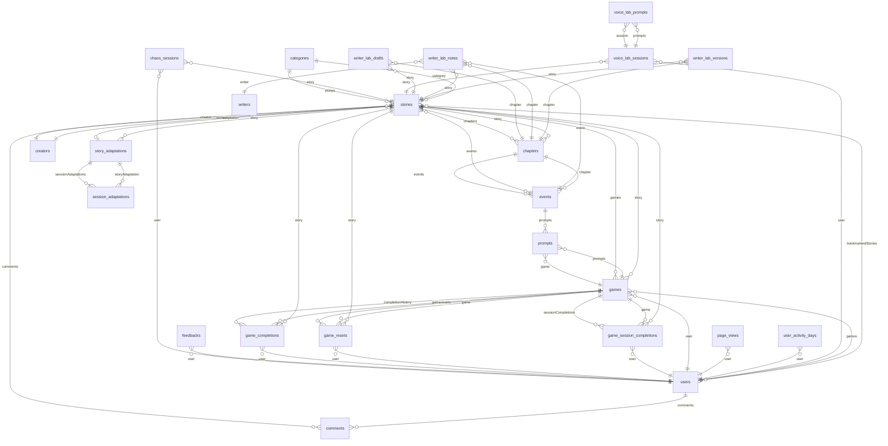

# LoreSpinner Database ERD

> Auto-generated from `php artisan model:show --json` for every Eloquent model.
> Regenerate with `php artisan schema:dump-erd`.

**Generated:** 2026-06-28T12:55:25+00:00
**Models documented:** 25

---

## Entity Relationship Diagram



---

## Tables Overview

| Model | Table | Database | Relations |
|-------|-------|----------|-----------|
| `Category` | `categories` | `pgsql` | 1 |
| `ChaosSession` | `chaos_sessions` | `pgsql` | 2 |
| `Chapter` | `chapters` | `pgsql` | 3 |
| `Comment` | `comments` | `pgsql` | 2 |
| `Creator` | `creators` | `pgsql` | 3 |
| `Event` | `events` | `pgsql` | 2 |
| `Feedback` | `feedbacks` | `pgsql` | 1 |
| `Game` | `games` | `pgsql` | 6 |
| `GameCompletion` | `game_completions` | `pgsql` | 3 |
| `GameReset` | `game_resets` | `pgsql` | 3 |
| `GameSessionCompletion` | `game_session_completions` | `pgsql` | 3 |
| `Manager` | `managers` | `pgsql` | 1 |
| `PageView` | `page_views` | `pgsql` | 1 |
| `Prompt` | `prompts` | `pgsql` | 1 |
| `SessionAdaptation` | `session_adaptations` | `pgsql` | 1 |
| `Story` | `stories` | `pgsql` | 8 |
| `StoryAdaptation` | `story_adaptations` | `pgsql` | 2 |
| `User` | `users` | `pgsql` | 5 |
| `UserActivityDay` | `user_activity_days` | `pgsql` | 1 |
| `Writer` | `writers` | `pgsql` | 1 |
| `WriterLabDraft` | `writer_lab_drafts` | `pgsql` | 2 |
| `WriterLabNote` | `writer_lab_notes` | `pgsql` | 4 |
| `WriterLabVersion` | `writer_lab_versions` | `pgsql` | 2 |
| `VoiceLabPrompt` | `voice_lab_prompts` | `pgsql` | 1 |
| `VoiceLabSession` | `voice_lab_sessions` | `pgsql` | 3 |

---

## Model Details

### `App\Models\Category`

- **Table:** `categories`
- **Database:** `pgsql`

#### Attributes

| Column | Type | Cast | Flags | Default |
|--------|------|------|-------|---------|
| `id` | bigint | int | increments, unique | nextval('categories_id_seq'::regclass) |
| `title` | character varying(255) | — | fillable | — |
| `created_at` | timestamp(0) without time zone | datetime | nullable | — |
| `updated_at` | timestamp(0) without time zone | datetime | nullable | — |

#### Relations

| Name | Type | Related |
|------|------|---------|
| `stories` | HasMany | `App\Models\Story` |

---

### `App\Models\ChaosSession`

- **Table:** `chaos_sessions`
- **Database:** `pgsql`

#### Attributes

| Column | Type | Cast | Flags | Default |
|--------|------|------|-------|---------|
| `id` | character(26) | — | unique | — |
| `story_id` | bigint | — | nullable, fillable | — |
| `user_id` | bigint | — | nullable, fillable | — |
| `story_session_number` | integer | integer | fillable | 1 |
| `model` | character varying(64) | — | fillable | — |
| `conversation_history` | json | json | nullable, fillable | — |
| `world_state` | json | json | nullable, fillable | — |
| `session_memory` | text | — | nullable, fillable | — |
| `session_complete` | boolean | boolean | fillable | false |
| `turn_count` | integer | integer | fillable | 0 |
| `ip_address` | character varying(45) | — | nullable, fillable | — |
| `created_at` | timestamp(0) without time zone | datetime | nullable | — |
| `updated_at` | timestamp(0) without time zone | datetime | nullable | — |
| `alignment_scaffold` | json | json | nullable, fillable | — |
| `symbolic_memory` | text | — | nullable, fillable | — |
| `defining_choice_id` | character varying(255) | — | nullable, fillable | — |
| `defining_choice_line` | text | — | nullable, fillable | — |
| `is_climactic_choice` | boolean | boolean | fillable | false |

#### Relations

| Name | Type | Related |
|------|------|---------|
| `story` | BelongsTo | `App\Models\Story` |
| `user` | BelongsTo | `App\Models\User` |

---

### `App\Models\Chapter`

- **Table:** `chapters`
- **Database:** `pgsql`

#### Attributes

| Column | Type | Cast | Flags | Default |
|--------|------|------|-------|---------|
| `id` | bigint | int | increments, unique | nextval('chapters_id_seq'::regclass) |
| `story_id` | bigint | — | fillable | — |
| `position` | integer | — | fillable | — |
| `title` | character varying(255) | — | fillable | — |
| `teaser` | text | — | fillable | — |
| `content` | text | — | fillable | — |
| `status` | character varying(255) | App\Enums\Chapter\ChapterStatusEnum | fillable | — |
| `created_at` | timestamp(0) without time zone | datetime | nullable | — |
| `updated_at` | timestamp(0) without time zone | datetime | nullable | — |

#### Relations

| Name | Type | Related |
|------|------|---------|
| `story` | BelongsTo | `App\Models\Story` |
| `events` | HasMany | `App\Models\Event` |
| `media` | MorphMany | `Spatie\MediaLibrary\MediaCollections\Models\Media` |

#### Observers

| Event | Observer |
|-------|----------|
| `deleting` | `Closure` |

---

### `App\Models\Comment`

- **Table:** `comments`
- **Database:** `pgsql`

#### Attributes

| Column | Type | Cast | Flags | Default |
|--------|------|------|-------|---------|
| `id` | bigint | int | increments, unique | nextval('comments_id_seq'::regclass) |
| `author_type` | character varying(255) | — | fillable | — |
| `author_id` | bigint | — | fillable | — |
| `commentable_type` | character varying(255) | — | fillable | — |
| `commentable_id` | bigint | — | fillable | — |
| `content` | text | — | fillable | — |
| `status` | character varying(255) | App\Enums\Comment\CommentStatusEnum | fillable | 'pending'::character varying |
| `approved_at` | timestamp(0) without time zone | — | nullable, fillable | — |
| `created_at` | timestamp(0) without time zone | datetime | nullable | — |
| `updated_at` | timestamp(0) without time zone | datetime | nullable | — |

#### Relations

| Name | Type | Related |
|------|------|---------|
| `commentable` | MorphTo | `App\Models\Comment` |
| `author` | MorphTo | `App\Models\Comment` |

---

### `App\Models\Creator`

- **Table:** `creators`
- **Database:** `pgsql`

#### Attributes

| Column | Type | Cast | Flags | Default |
|--------|------|------|-------|---------|
| `id` | bigint | int | increments, unique | nextval('creators_id_seq'::regclass) |
| `first_name` | character varying(255) | attribute | fillable | — |
| `last_name` | character varying(255) | attribute | fillable | — |
| `username` | character varying(255) | — | unique, fillable | — |
| `email` | character varying(255) | — | unique, fillable | — |
| `password` | character varying(255) | hashed | fillable, hidden | — |
| `avatar` | character varying(255) | attribute | nullable, fillable | — |
| `bio` | text | — | nullable, fillable | — |
| `is_active` | boolean | boolean | fillable, hidden | true |
| `email_verified_at` | timestamp(0) without time zone | datetime | nullable, fillable, hidden | — |
| `remember_token` | character varying(100) | — | nullable, fillable, hidden | — |
| `created_at` | timestamp(0) without time zone | datetime | nullable, hidden | — |
| `updated_at` | timestamp(0) without time zone | datetime | nullable, hidden | — |
| `full_name` | — | attribute | appended | — |

#### Relations

| Name | Type | Related |
|------|------|---------|
| `stories` | HasMany | `App\Models\Story` |
| `media` | MorphMany | `Spatie\MediaLibrary\MediaCollections\Models\Media` |
| `notifications` | MorphMany | `Illuminate\Notifications\DatabaseNotification` |

#### Observers

| Event | Observer |
|-------|----------|
| `deleting` | `Closure` |
| `created` | `Closure` |

---

### `App\Models\Event`

- **Table:** `events`
- **Database:** `pgsql`

#### Attributes

| Column | Type | Cast | Flags | Default |
|--------|------|------|-------|---------|
| `id` | bigint | int | increments, unique | nextval('events_id_seq'::regclass) |
| `chapter_id` | bigint | — | fillable | — |
| `position` | integer | — | fillable | 0 |
| `title` | character varying(255) | — | fillable | — |
| `content` | text | — | fillable | — |
| `objectives` | text | — | nullable, fillable | — |
| `attributes` | json | json | nullable, fillable | — |
| `created_at` | timestamp(0) without time zone | datetime | nullable | — |
| `updated_at` | timestamp(0) without time zone | datetime | nullable | — |
| `session_number` | integer | — | nullable, fillable | — |
| `requires_choice` | boolean | boolean | fillable | true |

#### Relations

| Name | Type | Related |
|------|------|---------|
| `chapter` | BelongsTo | `App\Models\Chapter` |
| `prompts` | HasMany | `App\Models\Prompt` |

---

### `App\Models\Feedback`

- **Table:** `feedbacks`
- **Database:** `pgsql`

#### Attributes

| Column | Type | Cast | Flags | Default |
|--------|------|------|-------|---------|
| `id` | bigint | int | increments, unique | nextval('feedbacks_id_seq'::regclass) |
| `user_id` | bigint | — | nullable, fillable | — |
| `content` | text | — | fillable | — |
| `page_url` | character varying(255) | — | nullable, fillable | — |
| `user_agent` | character varying(255) | — | nullable, fillable | — |
| `created_at` | timestamp(0) without time zone | datetime | nullable | — |
| `updated_at` | timestamp(0) without time zone | datetime | nullable | — |
| `screenshot_path` | character varying(255) | — | nullable, fillable | — |

#### Relations

| Name | Type | Related |
|------|------|---------|
| `user` | BelongsTo | `App\Models\User` |

#### Observers

| Event | Observer |
|-------|----------|
| `deleting` | `Closure` |

---

### `App\Models\Game`

- **Table:** `games`
- **Database:** `pgsql`

#### Attributes

| Column | Type | Cast | Flags | Default |
|--------|------|------|-------|---------|
| `id` | character(26) | — | unique | — |
| `story_id` | bigint | — | fillable | — |
| `user_id` | bigint | — | fillable | — |
| `created_at` | timestamp(0) without time zone | datetime | nullable | — |
| `updated_at` | timestamp(0) without time zone | datetime | nullable | — |
| `current_session_number` | integer | — | nullable, fillable | — |
| `world_state` | json | json | nullable, fillable | — |
| `is_preview` | boolean | boolean | fillable | false |
| `model` | character varying(64) | — | fillable | 'claude-haiku-4-5'::character varying |
| `symbolic_memory` | text | — | nullable, fillable | — |
| `alignment_scaffold` | json | json | nullable, fillable | — |
| `defining_choice_id` | character varying(128) | — | nullable, fillable | — |
| `defining_choice_line` | text | — | nullable, fillable | — |
| `is_climactic_choice` | boolean | boolean | fillable | false |
| `current_session_complete` | boolean | boolean | fillable | false |
| `completed_at` | timestamp(0) without time zone | datetime | nullable, fillable | — |
| `current_story_cycle_number` | smallint | — | fillable | '1'::smallint |

#### Relations

| Name | Type | Related |
|------|------|---------|
| `story` | BelongsTo | `App\Models\Story` |
| `user` | BelongsTo | `App\Models\User` |
| `prompts` | HasMany | `App\Models\Prompt` |
| `sessionCompletions` | HasMany | `App\Models\GameSessionCompletion` |
| `resets` | HasMany | `App\Models\GameReset` |
| `completionHistory` | HasMany | `App\Models\GameCompletion` |

---

### `App\Models\GameCompletion`

- **Table:** `game_completions`
- **Database:** `pgsql`

#### Attributes

| Column | Type | Cast | Flags | Default |
|--------|------|------|-------|---------|
| `id` | bigint | int | increments, unique | nextval('game_completions_id_seq'::regclass) |
| `game_id` | character(26) | — | fillable | — |
| `user_id` | bigint | — | fillable | — |
| `story_id` | bigint | — | fillable | — |
| `story_cycle_number` | smallint | integer | fillable | '1'::smallint |
| `completed_at` | timestamp(0) without time zone | datetime | fillable | — |
| `created_at` | timestamp(0) without time zone | datetime | nullable | — |
| `updated_at` | timestamp(0) without time zone | datetime | nullable | — |

#### Relations

| Name | Type | Related |
|------|------|---------|
| `game` | BelongsTo | `App\Models\Game` |
| `user` | BelongsTo | `App\Models\User` |
| `story` | BelongsTo | `App\Models\Story` |

---

### `App\Models\GameReset`

- **Table:** `game_resets`
- **Database:** `pgsql`

#### Attributes

| Column | Type | Cast | Flags | Default |
|--------|------|------|-------|---------|
| `id` | bigint | int | increments, unique | nextval('game_resets_id_seq'::regclass) |
| `game_id` | character(26) | — | fillable | — |
| `user_id` | bigint | — | fillable | — |
| `story_id` | bigint | — | fillable | — |
| `had_prior_completion` | boolean | boolean | fillable | false |
| `created_at` | timestamp(0) without time zone | datetime | nullable | — |
| `updated_at` | timestamp(0) without time zone | datetime | nullable | — |

#### Relations

| Name | Type | Related |
|------|------|---------|
| `game` | BelongsTo | `App\Models\Game` |
| `user` | BelongsTo | `App\Models\User` |
| `story` | BelongsTo | `App\Models\Story` |

---

### `App\Models\GameSessionCompletion`

- **Table:** `game_session_completions`
- **Database:** `pgsql`

#### Attributes

| Column | Type | Cast | Flags | Default |
|--------|------|------|-------|---------|
| `id` | bigint | int | increments, unique | nextval('game_session_completions_id_seq'::regclass) |
| `game_id` | character(26) | — | fillable | — |
| `story_id` | bigint | — | fillable | — |
| `user_id` | bigint | — | fillable | — |
| `session_number` | smallint | integer | fillable | — |
| `started_at` | timestamp(0) without time zone | datetime | nullable, fillable | — |
| `completed_at` | timestamp(0) without time zone | datetime | nullable, fillable | — |
| `created_at` | timestamp(0) without time zone | datetime | nullable | — |
| `updated_at` | timestamp(0) without time zone | datetime | nullable | — |
| `story_cycle_number` | smallint | integer | fillable | '1'::smallint |

#### Relations

| Name | Type | Related |
|------|------|---------|
| `game` | BelongsTo | `App\Models\Game` |
| `story` | BelongsTo | `App\Models\Story` |
| `user` | BelongsTo | `App\Models\User` |

---

### `App\Models\Manager`

- **Table:** `managers`
- **Database:** `pgsql`

#### Attributes

| Column | Type | Cast | Flags | Default |
|--------|------|------|-------|---------|
| `id` | bigint | int | increments, unique | nextval('managers_id_seq'::regclass) |
| `first_name` | character varying(255) | — | fillable | — |
| `last_name` | character varying(255) | — | fillable | — |
| `email` | character varying(255) | — | unique, fillable | — |
| `password` | character varying(255) | hashed | fillable, hidden | — |
| `remember_token` | character varying(100) | — | nullable, fillable, hidden | — |
| `created_at` | timestamp(0) without time zone | datetime | nullable | — |
| `updated_at` | timestamp(0) without time zone | datetime | nullable | — |
| `full_name` | — | attribute | appended | — |

#### Relations

| Name | Type | Related |
|------|------|---------|
| `notifications` | MorphMany | `Illuminate\Notifications\DatabaseNotification` |

---

### `App\Models\PageView`

- **Table:** `page_views`
- **Database:** `pgsql`

#### Attributes

| Column | Type | Cast | Flags | Default |
|--------|------|------|-------|---------|
| `id` | bigint | int | increments, unique | nextval('page_views_id_seq'::regclass) |
| `user_id` | bigint | — | nullable, fillable | — |
| `session_id` | character varying(40) | — | fillable | — |
| `path` | character varying(512) | — | fillable | — |
| `view_date` | date | date | fillable | — |
| `created_at` | timestamp(0) without time zone | datetime | nullable | — |
| `updated_at` | timestamp(0) without time zone | datetime | nullable | — |

#### Relations

| Name | Type | Related |
|------|------|---------|
| `user` | BelongsTo | `App\Models\User` |

---

### `App\Models\Prompt`

- **Table:** `prompts`
- **Database:** `pgsql`

#### Attributes

| Column | Type | Cast | Flags | Default |
|--------|------|------|-------|---------|
| `id` | character(26) | — | unique | — |
| `game_id` | character(26) | — | fillable | — |
| `response` | text | — | fillable | — |
| `choices` | json | array | nullable, fillable | — |
| `prompt` | text | — | nullable, fillable | — |
| `created_at` | timestamp(0) without time zone | datetime | nullable | — |
| `updated_at` | timestamp(0) without time zone | datetime | nullable | — |
| `session_number` | smallint | — | nullable, fillable | — |

#### Relations

| Name | Type | Related |
|------|------|---------|
| `game` | BelongsTo | `App\Models\Game` |

---

### `App\Models\SessionAdaptation`

- **Table:** `session_adaptations`
- **Database:** `pgsql`

#### Attributes

| Column | Type | Cast | Flags | Default |
|--------|------|------|-------|---------|
| `id` | bigint | int | increments, unique | nextval('session_adaptations_id_seq'::regclass) |
| `story_adaptation_id` | bigint | — | fillable | — |
| `session_number` | integer | — | fillable | — |
| `session_status` | character varying(255) | App\Enums\Adaptation\SessionAdaptationStatusEnum | fillable | 'pending'::character varying |
| `entry_point_diagnosis` | text | json | nullable, fillable | — |
| `session_architecture` | text | json | nullable, fillable | — |
| `session_choice_design` | text | json | nullable, fillable | — |
| `choice_consequence_map` | text | json | nullable, fillable | — |
| `session_close_design` | text | json | nullable, fillable | — |
| `editorial_verification` | text | json | nullable, fillable | — |
| `created_at` | timestamp(0) without time zone | datetime | nullable | — |
| `updated_at` | timestamp(0) without time zone | datetime | nullable | — |
| `runtime_narrator_prompt` | text | — | nullable, fillable | — |
| `runtime_narrator_assembled_at` | timestamp(0) without time zone | datetime | nullable, fillable | — |

#### Relations

| Name | Type | Related |
|------|------|---------|
| `storyAdaptation` | BelongsTo | `App\Models\StoryAdaptation` |

---

### `App\Models\Story`

- **Table:** `stories`
- **Database:** `pgsql`

#### Attributes

| Column | Type | Cast | Flags | Default |
|--------|------|------|-------|---------|
| `id` | bigint | int | increments, unique | nextval('stories_id_seq'::regclass) |
| `category_id` | bigint | — | fillable | — |
| `creator_id` | bigint | — | nullable, fillable | — |
| `title` | character varying(255) | — | fillable | — |
| `slug` | character varying(255) | — | unique, fillable | — |
| `teaser` | text | — | fillable | — |
| `opening` | text | — | nullable, fillable | — |
| `status` | character varying(255) | App\Enums\Story\StoryStatusEnum | fillable | 'draft'::character varying |
| `rating` | character varying(255) | App\Enums\Story\StoryRatingEnum | fillable | — |
| `published_at` | timestamp(0) without time zone | datetime | nullable, fillable | — |
| `created_at` | timestamp(0) without time zone | datetime | nullable | — |
| `updated_at` | timestamp(0) without time zone | datetime | nullable | — |
| `system_prompt` | text | json | nullable, fillable | — |

#### Relations

| Name | Type | Related |
|------|------|---------|
| `creator` | BelongsTo | `App\Models\Creator` |
| `category` | BelongsTo | `App\Models\Category` |
| `chapters` | HasMany | `App\Models\Chapter` |
| `events` | HasManyThrough | `App\Models\Event` |
| `games` | HasMany | `App\Models\Game` |
| `adaptation` | HasOne | `App\Models\StoryAdaptation` |
| `comments` | MorphMany | `App\Models\Comment` |
| `media` | MorphMany | `Spatie\MediaLibrary\MediaCollections\Models\Media` |

#### Observers

| Event | Observer |
|-------|----------|
| `deleting` | `Closure` |

---

### `App\Models\StoryAdaptation`

- **Table:** `story_adaptations`
- **Database:** `pgsql`

#### Attributes

| Column | Type | Cast | Flags | Default |
|--------|------|------|-------|---------|
| `id` | bigint | int | increments, unique | nextval('story_adaptations_id_seq'::regclass) |
| `story_id` | bigint | — | unique, fillable | — |
| `adaptation_status` | character varying(255) | App\Enums\Adaptation\AdaptationStatusEnum | fillable | 'pending'::character varying |
| `format_detection` | text | json | nullable, fillable | — |
| `ip_audit` | text | json | nullable, fillable | — |
| `story_session_map` | text | json | nullable, fillable | — |
| `created_at` | timestamp(0) without time zone | datetime | nullable | — |
| `updated_at` | timestamp(0) without time zone | datetime | nullable | — |
| `ip_trimming` | text | json | nullable, fillable | — |
| `voice_profile` | text | json | nullable, fillable | — |

#### Relations

| Name | Type | Related |
|------|------|---------|
| `story` | BelongsTo | `App\Models\Story` |
| `sessionAdaptations` | HasMany | `App\Models\SessionAdaptation` |

---

### `App\Models\User`

- **Table:** `users`
- **Database:** `pgsql`

#### Attributes

| Column | Type | Cast | Flags | Default |
|--------|------|------|-------|---------|
| `id` | bigint | int | increments, unique | nextval('users_id_seq'::regclass) |
| `first_name` | character varying(255) | — | nullable, fillable | — |
| `last_name` | character varying(255) | — | nullable, fillable | — |
| `gender` | character varying(255) | — | nullable, fillable | — |
| `username` | character varying(255) | attribute | unique, nullable, fillable | — |
| `email` | character varying(255) | — | unique, fillable | — |
| `password` | character varying(255) | hashed | fillable, hidden | — |
| `avatar` | character varying(255) | attribute | nullable, fillable | — |
| `bio` | text | — | nullable, fillable | — |
| `is_active` | boolean | boolean | fillable, hidden | true |
| `email_verified_at` | timestamp(0) without time zone | datetime | nullable, fillable, hidden | — |
| `remember_token` | character varying(100) | — | nullable, fillable, hidden | — |
| `created_at` | timestamp(0) without time zone | datetime | nullable, hidden | — |
| `updated_at` | timestamp(0) without time zone | datetime | nullable, hidden | — |
| `is_profile_completed` | — | attribute | appended | — |
| `full_name` | — | attribute | appended | — |

#### Relations

| Name | Type | Related |
|------|------|---------|
| `comments` | MorphMany | `App\Models\Comment` |
| `games` | HasMany | `App\Models\Game` |
| `bookmarkedStories` | BelongsToMany | `App\Models\Story` |
| `media` | MorphMany | `Spatie\MediaLibrary\MediaCollections\Models\Media` |
| `notifications` | MorphMany | `Illuminate\Notifications\DatabaseNotification` |

#### Observers

| Event | Observer |
|-------|----------|
| `deleting` | `Closure` |

---

### `App\Models\UserActivityDay`

- **Table:** `user_activity_days`
- **Database:** `pgsql`

#### Attributes

| Column | Type | Cast | Flags | Default |
|--------|------|------|-------|---------|
| `id` | bigint | int | increments, unique | nextval('user_activity_days_id_seq'::regclass) |
| `user_id` | bigint | — | fillable | — |
| `activity_date` | date | date | fillable | — |
| `created_at` | timestamp(0) without time zone | datetime | nullable | — |
| `updated_at` | timestamp(0) without time zone | datetime | nullable | — |

#### Relations

| Name | Type | Related |
|------|------|---------|
| `user` | BelongsTo | `App\Models\User` |

---

### `App\Models\Writer`

- **Table:** `writers`
- **Database:** `pgsql`

#### Attributes

| Column | Type | Cast | Flags | Default |
|--------|------|------|-------|---------|
| `id` | bigint | int | increments, unique | nextval('writers_id_seq'::regclass) |
| `name` | character varying(255) | — | fillable | — |
| `email` | character varying(255) | — | unique, fillable | — |
| `password` | character varying(255) | hashed | fillable, hidden | — |
| `remember_token` | character varying(100) | — | nullable, fillable, hidden | — |
| `created_at` | timestamp(0) without time zone | datetime | nullable | — |
| `updated_at` | timestamp(0) without time zone | datetime | nullable | — |

#### Relations

| Name | Type | Related |
|------|------|---------|
| `notifications` | MorphMany | `Illuminate\Notifications\DatabaseNotification` |

---

### `App\Models\WriterLabDraft`

- **Table:** `writer_lab_drafts`
- **Database:** `pgsql`

#### Attributes

| Column | Type | Cast | Flags | Default |
|--------|------|------|-------|---------|
| `id` | bigint | int | increments, unique | nextval('writer_lab_drafts_id_seq'::regclass) |
| `story_id` | bigint | — | fillable | — |
| `chapter_id` | bigint | — | fillable | — |
| `session_number` | integer | — | nullable, fillable | — |
| `type` | character varying(255) | — | fillable | 'combine'::character varying |
| `source_event_ids` | json | array | nullable, fillable | — |
| `rewritten_content` | text | — | nullable, fillable | — |
| `derived_objectives` | text | — | nullable, fillable | — |
| `derived_attributes` | json | array | nullable, fillable | — |
| `beat_type` | character varying(255) | — | nullable, fillable | — |
| `requires_choice` | boolean | boolean | fillable | true |
| `canonical_anchors` | json | array | nullable, fillable | — |
| `split_parts` | json | array | nullable, fillable | — |
| `event_order` | json | array | nullable, fillable | — |
| `previous_state` | json | array | nullable, fillable | — |
| `adaptation_patch` | json | array | nullable, fillable | — |
| `status` | character varying(255) | — | fillable | 'draft'::character varying |
| `activated_at` | timestamp(0) without time zone | datetime | nullable, fillable | — |
| `created_at` | timestamp(0) without time zone | datetime | nullable | — |
| `updated_at` | timestamp(0) without time zone | datetime | nullable | — |

#### Relations

| Name | Type | Related |
|------|------|---------|
| `story` | BelongsTo | `App\Models\Story` |
| `chapter` | BelongsTo | `App\Models\Chapter` |

---

### `App\Models\WriterLabNote`

- **Table:** `writer_lab_notes`
- **Database:** `pgsql`

#### Attributes

| Column | Type | Cast | Flags | Default |
|--------|------|------|-------|---------|
| `id` | bigint | int | increments, unique | nextval('writer_lab_notes_id_seq'::regclass) |
| `story_id` | bigint | — | fillable | — |
| `chapter_id` | bigint | — | fillable | — |
| `event_id` | bigint | — | nullable, fillable | — |
| `writer_id` | bigint | — | nullable, fillable | — |
| `author_name` | character varying(80) | — | fillable | — |
| `body` | text | — | fillable | — |
| `is_resolved` | boolean | boolean | fillable | false |
| `created_at` | timestamp(0) without time zone | datetime | nullable, fillable | — |
| `updated_at` | timestamp(0) without time zone | datetime | nullable, fillable | — |

#### Relations

| Name | Type | Related |
|------|------|---------|
| `story` | BelongsTo | `App\Models\Story` |
| `chapter` | BelongsTo | `App\Models\Chapter` |
| `event` | BelongsTo | `App\Models\Event` |
| `writer` | BelongsTo | `App\Models\Writer` |

---

### `App\Models\WriterLabVersion`

- **Table:** `writer_lab_versions`
- **Database:** `pgsql`

#### Attributes

| Column | Type | Cast | Flags | Default |
|--------|------|------|-------|---------|
| `id` | bigint | int | increments, unique | nextval('writer_lab_versions_id_seq'::regclass) |
| `story_id` | bigint | — | fillable | — |
| `session_number` | integer | — | fillable | — |
| `version_number` | integer | — | fillable | — |
| `snapshot_events` | json | array | fillable | — |
| `snapshot_adaptation` | json | array | nullable, fillable | — |
| `is_active` | boolean | boolean | fillable | false |
| `note` | character varying(255) | — | nullable, fillable | — |
| `created_at` | timestamp(0) without time zone | datetime | fillable | CURRENT_TIMESTAMP |
| `chapter_id` | bigint | — | nullable, fillable | — |
| `snapshot_kind` | character varying(16) | — | fillable | 'session'::character varying |
| `snapshot_adaptations` | json | array | nullable, fillable | — |

#### Relations

| Name | Type | Related |
|------|------|---------|
| `story` | BelongsTo | `App\Models\Story` |
| `chapter` | BelongsTo | `App\Models\Chapter` |

---

### `App\VoiceLab\Models\VoiceLabPrompt`

- **Table:** `voice_lab_prompts`
- **Database:** `pgsql`

#### Attributes

| Column | Type | Cast | Flags | Default |
|--------|------|------|-------|---------|
| `id` | character(26) | — | unique | — |
| `session_id` | character(26) | — | fillable | — |
| `role` | character varying(16) | App\VoiceLab\Enums\VoiceLabRoleEnum | fillable | — |
| `text` | text | — | fillable | — |
| `choices` | json | array | nullable, fillable | — |
| `audio_ms` | integer | — | nullable, fillable | — |
| `created_at` | timestamp(0) without time zone | datetime | nullable | — |
| `updated_at` | timestamp(0) without time zone | datetime | nullable | — |

#### Relations

| Name | Type | Related |
|------|------|---------|
| `session` | BelongsTo | `App\VoiceLab\Models\VoiceLabSession` |

---

### `App\VoiceLab\Models\VoiceLabSession`

- **Table:** `voice_lab_sessions`
- **Database:** `pgsql`

#### Attributes

| Column | Type | Cast | Flags | Default |
|--------|------|------|-------|---------|
| `id` | character(26) | — | unique | — |
| `user_id` | bigint | — | fillable | — |
| `story_id` | bigint | — | nullable, fillable | — |
| `ended_at` | timestamp(0) without time zone | datetime | nullable, fillable | — |
| `created_at` | timestamp(0) without time zone | datetime | nullable | — |
| `updated_at` | timestamp(0) without time zone | datetime | nullable | — |

#### Relations

| Name | Type | Related |
|------|------|---------|
| `user` | BelongsTo | `App\Models\User` |
| `story` | BelongsTo | `App\Models\Story` |
| `prompts` | HasMany | `App\VoiceLab\Models\VoiceLabPrompt` |

---

---

## Raw JSON

<details>
<summary>Full model:show payloads</summary>

```json
{
    "App\\Models\\Category": {
        "class": "App\\Models\\Category",
        "database": "pgsql",
        "table": "categories",
        "policy": null,
        "attributes": [
            {
                "name": "id",
                "type": "bigint",
                "increments": true,
                "nullable": false,
                "default": "nextval('categories_id_seq'::regclass)",
                "unique": true,
                "fillable": false,
                "hidden": false,
                "appended": null,
                "cast": "int"
            },
            {
                "name": "title",
                "type": "character varying(255)",
                "increments": false,
                "nullable": false,
                "default": null,
                "unique": false,
                "fillable": true,
                "hidden": false,
                "appended": null,
                "cast": null
            },
            {
                "name": "created_at",
                "type": "timestamp(0) without time zone",
                "increments": false,
                "nullable": true,
                "default": null,
                "unique": false,
                "fillable": false,
                "hidden": false,
                "appended": null,
                "cast": "datetime"
            },
            {
                "name": "updated_at",
                "type": "timestamp(0) without time zone",
                "increments": false,
                "nullable": true,
                "default": null,
                "unique": false,
                "fillable": false,
                "hidden": false,
                "appended": null,
                "cast": "datetime"
            }
        ],
        "relations": [
            {
                "name": "stories",
                "type": "HasMany",
                "related": "App\\Models\\Story"
            }
        ],
        "events": [],
        "observers": []
    },
    "App\\Models\\ChaosSession": {
        "class": "App\\Models\\ChaosSession",
        "database": "pgsql",
        "table": "chaos_sessions",
        "policy": null,
        "attributes": [
            {
                "name": "id",
                "type": "character(26)",
                "increments": false,
                "nullable": false,
                "default": null,
                "unique": true,
                "fillable": false,
                "hidden": false,
                "appended": null,
                "cast": null
            },
            {
                "name": "story_id",
                "type": "bigint",
                "increments": false,
                "nullable": true,
                "default": null,
                "unique": false,
                "fillable": true,
                "hidden": false,
                "appended": null,
                "cast": null
            },
            {
                "name": "user_id",
                "type": "bigint",
                "increments": false,
                "nullable": true,
                "default": null,
                "unique": false,
                "fillable": true,
                "hidden": false,
                "appended": null,
                "cast": null
            },
            {
                "name": "story_session_number",
                "type": "integer",
                "increments": false,
                "nullable": false,
                "default": "1",
                "unique": false,
                "fillable": true,
                "hidden": false,
                "appended": null,
                "cast": "integer"
            },
            {
                "name": "model",
                "type": "character varying(64)",
                "increments": false,
                "nullable": false,
                "default": null,
                "unique": false,
                "fillable": true,
                "hidden": false,
                "appended": null,
                "cast": null
            },
            {
                "name": "conversation_history",
                "type": "json",
                "increments": false,
                "nullable": true,
                "default": null,
                "unique": false,
                "fillable": true,
                "hidden": false,
                "appended": null,
                "cast": "json"
            },
            {
                "name": "world_state",
                "type": "json",
                "increments": false,
                "nullable": true,
                "default": null,
                "unique": false,
                "fillable": true,
                "hidden": false,
                "appended": null,
                "cast": "json"
            },
            {
                "name": "session_memory",
                "type": "text",
                "increments": false,
                "nullable": true,
                "default": null,
                "unique": false,
                "fillable": true,
                "hidden": false,
                "appended": null,
                "cast": null
            },
            {
                "name": "session_complete",
                "type": "boolean",
                "increments": false,
                "nullable": false,
                "default": "false",
                "unique": false,
                "fillable": true,
                "hidden": false,
                "appended": null,
                "cast": "boolean"
            },
            {
                "name": "turn_count",
                "type": "integer",
                "increments": false,
                "nullable": false,
                "default": "0",
                "unique": false,
                "fillable": true,
                "hidden": false,
                "appended": null,
                "cast": "integer"
            },
            {
                "name": "ip_address",
                "type": "character varying(45)",
                "increments": false,
                "nullable": true,
                "default": null,
                "unique": false,
                "fillable": true,
                "hidden": false,
                "appended": null,
                "cast": null
            },
            {
                "name": "created_at",
                "type": "timestamp(0) without time zone",
                "increments": false,
                "nullable": true,
                "default": null,
                "unique": false,
                "fillable": false,
                "hidden": false,
                "appended": null,
                "cast": "datetime"
            },
            {
                "name": "updated_at",
                "type": "timestamp(0) without time zone",
                "increments": false,
                "nullable": true,
                "default": null,
                "unique": false,
                "fillable": false,
                "hidden": false,
                "appended": null,
                "cast": "datetime"
            },
            {
                "name": "alignment_scaffold",
                "type": "json",
                "increments": false,
                "nullable": true,
                "default": null,
                "unique": false,
                "fillable": true,
                "hidden": false,
                "appended": null,
                "cast": "json"
            },
            {
                "name": "symbolic_memory",
                "type": "text",
                "increments": false,
                "nullable": true,
                "default": null,
                "unique": false,
                "fillable": true,
                "hidden": false,
                "appended": null,
                "cast": null
            },
            {
                "name": "defining_choice_id",
                "type": "character varying(255)",
                "increments": false,
                "nullable": true,
                "default": null,
                "unique": false,
                "fillable": true,
                "hidden": false,
                "appended": null,
                "cast": null
            },
            {
                "name": "defining_choice_line",
                "type": "text",
                "increments": false,
                "nullable": true,
                "default": null,
                "unique": false,
                "fillable": true,
                "hidden": false,
                "appended": null,
                "cast": null
            },
            {
                "name": "is_climactic_choice",
                "type": "boolean",
                "increments": false,
                "nullable": false,
                "default": "false",
                "unique": false,
                "fillable": true,
                "hidden": false,
                "appended": null,
                "cast": "boolean"
            }
        ],
        "relations": [
            {
                "name": "story",
                "type": "BelongsTo",
                "related": "App\\Models\\Story"
            },
            {
                "name": "user",
                "type": "BelongsTo",
                "related": "App\\Models\\User"
            }
        ],
        "events": [],
        "observers": []
    },
    "App\\Models\\Chapter": {
        "class": "App\\Models\\Chapter",
        "database": "pgsql",
        "table": "chapters",
        "policy": null,
        "attributes": [
            {
                "name": "id",
                "type": "bigint",
                "increments": true,
                "nullable": false,
                "default": "nextval('chapters_id_seq'::regclass)",
                "unique": true,
                "fillable": false,
                "hidden": false,
                "appended": null,
                "cast": "int"
            },
            {
                "name": "story_id",
                "type": "bigint",
                "increments": false,
                "nullable": false,
                "default": null,
                "unique": false,
                "fillable": true,
                "hidden": false,
                "appended": null,
                "cast": null
            },
            {
                "name": "position",
                "type": "integer",
                "increments": false,
                "nullable": false,
                "default": null,
                "unique": false,
                "fillable": true,
                "hidden": false,
                "appended": null,
                "cast": null
            },
            {
                "name": "title",
                "type": "character varying(255)",
                "increments": false,
                "nullable": false,
                "default": null,
                "unique": false,
                "fillable": true,
                "hidden": false,
                "appended": null,
                "cast": null
            },
            {
                "name": "teaser",
                "type": "text",
                "increments": false,
                "nullable": false,
                "default": null,
                "unique": false,
                "fillable": true,
                "hidden": false,
                "appended": null,
                "cast": null
            },
            {
                "name": "content",
                "type": "text",
                "increments": false,
                "nullable": false,
                "default": null,
                "unique": false,
                "fillable": true,
                "hidden": false,
                "appended": null,
                "cast": null
            },
            {
                "name": "status",
                "type": "character varying(255)",
                "increments": false,
                "nullable": false,
                "default": null,
                "unique": false,
                "fillable": true,
                "hidden": false,
                "appended": null,
                "cast": "App\\Enums\\Chapter\\ChapterStatusEnum"
            },
            {
                "name": "created_at",
                "type": "timestamp(0) without time zone",
                "increments": false,
                "nullable": true,
                "default": null,
                "unique": false,
                "fillable": false,
                "hidden": false,
                "appended": null,
                "cast": "datetime"
            },
            {
                "name": "updated_at",
                "type": "timestamp(0) without time zone",
                "increments": false,
                "nullable": true,
                "default": null,
                "unique": false,
                "fillable": false,
                "hidden": false,
                "appended": null,
                "cast": "datetime"
            }
        ],
        "relations": [
            {
                "name": "story",
                "type": "BelongsTo",
                "related": "App\\Models\\Story"
            },
            {
                "name": "events",
                "type": "HasMany",
                "related": "App\\Models\\Event"
            },
            {
                "name": "media",
                "type": "MorphMany",
                "related": "Spatie\\MediaLibrary\\MediaCollections\\Models\\Media"
            }
        ],
        "events": [],
        "observers": [
            {
                "event": "deleting",
                "observer": [
                    "Closure"
                ]
            }
        ]
    },
    "App\\Models\\Comment": {
        "class": "App\\Models\\Comment",
        "database": "pgsql",
        "table": "comments",
        "policy": null,
        "attributes": [
            {
                "name": "id",
                "type": "bigint",
                "increments": true,
                "nullable": false,
                "default": "nextval('comments_id_seq'::regclass)",
                "unique": true,
                "fillable": false,
                "hidden": false,
                "appended": null,
                "cast": "int"
            },
            {
                "name": "author_type",
                "type": "character varying(255)",
                "increments": false,
                "nullable": false,
                "default": null,
                "unique": false,
                "fillable": true,
                "hidden": false,
                "appended": null,
                "cast": null
            },
            {
                "name": "author_id",
                "type": "bigint",
                "increments": false,
                "nullable": false,
                "default": null,
                "unique": false,
                "fillable": true,
                "hidden": false,
                "appended": null,
                "cast": null
            },
            {
                "name": "commentable_type",
                "type": "character varying(255)",
                "increments": false,
                "nullable": false,
                "default": null,
                "unique": false,
                "fillable": true,
                "hidden": false,
                "appended": null,
                "cast": null
            },
            {
                "name": "commentable_id",
                "type": "bigint",
                "increments": false,
                "nullable": false,
                "default": null,
                "unique": false,
                "fillable": true,
                "hidden": false,
                "appended": null,
                "cast": null
            },
            {
                "name": "content",
                "type": "text",
                "increments": false,
                "nullable": false,
                "default": null,
                "unique": false,
                "fillable": true,
                "hidden": false,
                "appended": null,
                "cast": null
            },
            {
                "name": "status",
                "type": "character varying(255)",
                "increments": false,
                "nullable": false,
                "default": "'pending'::character varying",
                "unique": false,
                "fillable": true,
                "hidden": false,
                "appended": null,
                "cast": "App\\Enums\\Comment\\CommentStatusEnum"
            },
            {
                "name": "approved_at",
                "type": "timestamp(0) without time zone",
                "increments": false,
                "nullable": true,
                "default": null,
                "unique": false,
                "fillable": true,
                "hidden": false,
                "appended": null,
                "cast": null
            },
            {
                "name": "created_at",
                "type": "timestamp(0) without time zone",
                "increments": false,
                "nullable": true,
                "default": null,
                "unique": false,
                "fillable": false,
                "hidden": false,
                "appended": null,
                "cast": "datetime"
            },
            {
                "name": "updated_at",
                "type": "timestamp(0) without time zone",
                "increments": false,
                "nullable": true,
                "default": null,
                "unique": false,
                "fillable": false,
                "hidden": false,
                "appended": null,
                "cast": "datetime"
            }
        ],
        "relations": [
            {
                "name": "commentable",
                "type": "MorphTo",
                "related": "App\\Models\\Comment"
            },
            {
                "name": "author",
                "type": "MorphTo",
                "related": "App\\Models\\Comment"
            }
        ],
        "events": [],
        "observers": []
    },
    "App\\Models\\Creator": {
        "class": "App\\Models\\Creator",
        "database": "pgsql",
        "table": "creators",
        "policy": null,
        "attributes": [
            {
                "name": "id",
                "type": "bigint",
                "increments": true,
                "nullable": false,
                "default": "nextval('creators_id_seq'::regclass)",
                "unique": true,
                "fillable": false,
                "hidden": false,
                "appended": null,
                "cast": "int"
            },
            {
                "name": "first_name",
                "type": "character varying(255)",
                "increments": false,
                "nullable": false,
                "default": null,
                "unique": false,
                "fillable": true,
                "hidden": false,
                "appended": null,
                "cast": "attribute"
            },
            {
                "name": "last_name",
                "type": "character varying(255)",
                "increments": false,
                "nullable": false,
                "default": null,
                "unique": false,
                "fillable": true,
                "hidden": false,
                "appended": null,
                "cast": "attribute"
            },
            {
                "name": "username",
                "type": "character varying(255)",
                "increments": false,
                "nullable": false,
                "default": null,
                "unique": true,
                "fillable": true,
                "hidden": false,
                "appended": null,
                "cast": null
            },
            {
                "name": "email",
                "type": "character varying(255)",
                "increments": false,
                "nullable": false,
                "default": null,
                "unique": true,
                "fillable": true,
                "hidden": false,
                "appended": null,
                "cast": null
            },
            {
                "name": "password",
                "type": "character varying(255)",
                "increments": false,
                "nullable": false,
                "default": null,
                "unique": false,
                "fillable": true,
                "hidden": true,
                "appended": null,
                "cast": "hashed"
            },
            {
                "name": "avatar",
                "type": "character varying(255)",
                "increments": false,
                "nullable": true,
                "default": null,
                "unique": false,
                "fillable": true,
                "hidden": false,
                "appended": null,
                "cast": "attribute"
            },
            {
                "name": "bio",
                "type": "text",
                "increments": false,
                "nullable": true,
                "default": null,
                "unique": false,
                "fillable": true,
                "hidden": false,
                "appended": null,
                "cast": null
            },
            {
                "name": "is_active",
                "type": "boolean",
                "increments": false,
                "nullable": false,
                "default": "true",
                "unique": false,
                "fillable": true,
                "hidden": true,
                "appended": null,
                "cast": "boolean"
            },
            {
                "name": "email_verified_at",
                "type": "timestamp(0) without time zone",
                "increments": false,
                "nullable": true,
                "default": null,
                "unique": false,
                "fillable": true,
                "hidden": true,
                "appended": null,
                "cast": "datetime"
            },
            {
                "name": "remember_token",
                "type": "character varying(100)",
                "increments": false,
                "nullable": true,
                "default": null,
                "unique": false,
                "fillable": true,
                "hidden": true,
                "appended": null,
                "cast": null
            },
            {
                "name": "created_at",
                "type": "timestamp(0) without time zone",
                "increments": false,
                "nullable": true,
                "default": null,
                "unique": false,
                "fillable": false,
                "hidden": true,
                "appended": null,
                "cast": "datetime"
            },
            {
                "name": "updated_at",
                "type": "timestamp(0) without time zone",
                "increments": false,
                "nullable": true,
                "default": null,
                "unique": false,
                "fillable": false,
                "hidden": true,
                "appended": null,
                "cast": "datetime"
            },
            {
                "name": "full_name",
                "type": null,
                "increments": false,
                "nullable": null,
                "default": null,
                "unique": null,
                "fillable": false,
                "hidden": false,
                "appended": true,
                "cast": "attribute"
            }
        ],
        "relations": [
            {
                "name": "stories",
                "type": "HasMany",
                "related": "App\\Models\\Story"
            },
            {
                "name": "media",
                "type": "MorphMany",
                "related": "Spatie\\MediaLibrary\\MediaCollections\\Models\\Media"
            },
            {
                "name": "notifications",
                "type": "MorphMany",
                "related": "Illuminate\\Notifications\\DatabaseNotification"
            }
        ],
        "events": [],
        "observers": [
            {
                "event": "deleting",
                "observer": [
                    "Closure"
                ]
            },
            {
                "event": "created",
                "observer": [
                    "Closure"
                ]
            }
        ]
    },
    "App\\Models\\Event": {
        "class": "App\\Models\\Event",
        "database": "pgsql",
        "table": "events",
        "policy": null,
        "attributes": [
            {
                "name": "id",
                "type": "bigint",
                "increments": true,
                "nullable": false,
                "default": "nextval('events_id_seq'::regclass)",
                "unique": true,
                "fillable": false,
                "hidden": false,
                "appended": null,
                "cast": "int"
            },
            {
                "name": "chapter_id",
                "type": "bigint",
                "increments": false,
                "nullable": false,
                "default": null,
                "unique": false,
                "fillable": true,
                "hidden": false,
                "appended": null,
                "cast": null
            },
            {
                "name": "position",
                "type": "integer",
                "increments": false,
                "nullable": false,
                "default": "0",
                "unique": false,
                "fillable": true,
                "hidden": false,
                "appended": null,
                "cast": null
            },
            {
                "name": "title",
                "type": "character varying(255)",
                "increments": false,
                "nullable": false,
                "default": null,
                "unique": false,
                "fillable": true,
                "hidden": false,
                "appended": null,
                "cast": null
            },
            {
                "name": "content",
                "type": "text",
                "increments": false,
                "nullable": false,
                "default": null,
                "unique": false,
                "fillable": true,
                "hidden": false,
                "appended": null,
                "cast": null
            },
            {
                "name": "objectives",
                "type": "text",
                "increments": false,
                "nullable": true,
                "default": null,
                "unique": false,
                "fillable": true,
                "hidden": false,
                "appended": null,
                "cast": null
            },
            {
                "name": "attributes",
                "type": "json",
                "increments": false,
                "nullable": true,
                "default": null,
                "unique": false,
                "fillable": true,
                "hidden": false,
                "appended": null,
                "cast": "json"
            },
            {
                "name": "created_at",
                "type": "timestamp(0) without time zone",
                "increments": false,
                "nullable": true,
                "default": null,
                "unique": false,
                "fillable": false,
                "hidden": false,
                "appended": null,
                "cast": "datetime"
            },
            {
                "name": "updated_at",
                "type": "timestamp(0) without time zone",
                "increments": false,
                "nullable": true,
                "default": null,
                "unique": false,
                "fillable": false,
                "hidden": false,
                "appended": null,
                "cast": "datetime"
            },
            {
                "name": "session_number",
                "type": "integer",
                "increments": false,
                "nullable": true,
                "default": null,
                "unique": false,
                "fillable": true,
                "hidden": false,
                "appended": null,
                "cast": null
            },
            {
                "name": "requires_choice",
                "type": "boolean",
                "increments": false,
                "nullable": false,
                "default": "true",
                "unique": false,
                "fillable": true,
                "hidden": false,
                "appended": null,
                "cast": "boolean"
            }
        ],
        "relations": [
            {
                "name": "chapter",
                "type": "BelongsTo",
                "related": "App\\Models\\Chapter"
            },
            {
                "name": "prompts",
                "type": "HasMany",
                "related": "App\\Models\\Prompt"
            }
        ],
        "events": [],
        "observers": []
    },
    "App\\Models\\Feedback": {
        "class": "App\\Models\\Feedback",
        "database": "pgsql",
        "table": "feedbacks",
        "policy": null,
        "attributes": [
            {
                "name": "id",
                "type": "bigint",
                "increments": true,
                "nullable": false,
                "default": "nextval('feedbacks_id_seq'::regclass)",
                "unique": true,
                "fillable": false,
                "hidden": false,
                "appended": null,
                "cast": "int"
            },
            {
                "name": "user_id",
                "type": "bigint",
                "increments": false,
                "nullable": true,
                "default": null,
                "unique": false,
                "fillable": true,
                "hidden": false,
                "appended": null,
                "cast": null
            },
            {
                "name": "content",
                "type": "text",
                "increments": false,
                "nullable": false,
                "default": null,
                "unique": false,
                "fillable": true,
                "hidden": false,
                "appended": null,
                "cast": null
            },
            {
                "name": "page_url",
                "type": "character varying(255)",
                "increments": false,
                "nullable": true,
                "default": null,
                "unique": false,
                "fillable": true,
                "hidden": false,
                "appended": null,
                "cast": null
            },
            {
                "name": "user_agent",
                "type": "character varying(255)",
                "increments": false,
                "nullable": true,
                "default": null,
                "unique": false,
                "fillable": true,
                "hidden": false,
                "appended": null,
                "cast": null
            },
            {
                "name": "created_at",
                "type": "timestamp(0) without time zone",
                "increments": false,
                "nullable": true,
                "default": null,
                "unique": false,
                "fillable": false,
                "hidden": false,
                "appended": null,
                "cast": "datetime"
            },
            {
                "name": "updated_at",
                "type": "timestamp(0) without time zone",
                "increments": false,
                "nullable": true,
                "default": null,
                "unique": false,
                "fillable": false,
                "hidden": false,
                "appended": null,
                "cast": "datetime"
            },
            {
                "name": "screenshot_path",
                "type": "character varying(255)",
                "increments": false,
                "nullable": true,
                "default": null,
                "unique": false,
                "fillable": true,
                "hidden": false,
                "appended": null,
                "cast": null
            }
        ],
        "relations": [
            {
                "name": "user",
                "type": "BelongsTo",
                "related": "App\\Models\\User"
            }
        ],
        "events": [],
        "observers": [
            {
                "event": "deleting",
                "observer": [
                    "Closure"
                ]
            }
        ]
    },
    "App\\Models\\Game": {
        "class": "App\\Models\\Game",
        "database": "pgsql",
        "table": "games",
        "policy": null,
        "attributes": [
            {
                "name": "id",
                "type": "character(26)",
                "increments": false,
                "nullable": false,
                "default": null,
                "unique": true,
                "fillable": false,
                "hidden": false,
                "appended": null,
                "cast": null
            },
            {
                "name": "story_id",
                "type": "bigint",
                "increments": false,
                "nullable": false,
                "default": null,
                "unique": false,
                "fillable": true,
                "hidden": false,
                "appended": null,
                "cast": null
            },
            {
                "name": "user_id",
                "type": "bigint",
                "increments": false,
                "nullable": false,
                "default": null,
                "unique": false,
                "fillable": true,
                "hidden": false,
                "appended": null,
                "cast": null
            },
            {
                "name": "created_at",
                "type": "timestamp(0) without time zone",
                "increments": false,
                "nullable": true,
                "default": null,
                "unique": false,
                "fillable": false,
                "hidden": false,
                "appended": null,
                "cast": "datetime"
            },
            {
                "name": "updated_at",
                "type": "timestamp(0) without time zone",
                "increments": false,
                "nullable": true,
                "default": null,
                "unique": false,
                "fillable": false,
                "hidden": false,
                "appended": null,
                "cast": "datetime"
            },
            {
                "name": "current_session_number",
                "type": "integer",
                "increments": false,
                "nullable": true,
                "default": null,
                "unique": false,
                "fillable": true,
                "hidden": false,
                "appended": null,
                "cast": null
            },
            {
                "name": "world_state",
                "type": "json",
                "increments": false,
                "nullable": true,
                "default": null,
                "unique": false,
                "fillable": true,
                "hidden": false,
                "appended": null,
                "cast": "json"
            },
            {
                "name": "is_preview",
                "type": "boolean",
                "increments": false,
                "nullable": false,
                "default": "false",
                "unique": false,
                "fillable": true,
                "hidden": false,
                "appended": null,
                "cast": "boolean"
            },
            {
                "name": "model",
                "type": "character varying(64)",
                "increments": false,
                "nullable": false,
                "default": "'claude-haiku-4-5'::character varying",
                "unique": false,
                "fillable": true,
                "hidden": false,
                "appended": null,
                "cast": null
            },
            {
                "name": "symbolic_memory",
                "type": "text",
                "increments": false,
                "nullable": true,
                "default": null,
                "unique": false,
                "fillable": true,
                "hidden": false,
                "appended": null,
                "cast": null
            },
            {
                "name": "alignment_scaffold",
                "type": "json",
                "increments": false,
                "nullable": true,
                "default": null,
                "unique": false,
                "fillable": true,
                "hidden": false,
                "appended": null,
                "cast": "json"
            },
            {
                "name": "defining_choice_id",
                "type": "character varying(128)",
                "increments": false,
                "nullable": true,
                "default": null,
                "unique": false,
                "fillable": true,
                "hidden": false,
                "appended": null,
                "cast": null
            },
            {
                "name": "defining_choice_line",
                "type": "text",
                "increments": false,
                "nullable": true,
                "default": null,
                "unique": false,
                "fillable": true,
                "hidden": false,
                "appended": null,
                "cast": null
            },
            {
                "name": "is_climactic_choice",
                "type": "boolean",
                "increments": false,
                "nullable": false,
                "default": "false",
                "unique": false,
                "fillable": true,
                "hidden": false,
                "appended": null,
                "cast": "boolean"
            },
            {
                "name": "current_session_complete",
                "type": "boolean",
                "increments": false,
                "nullable": false,
                "default": "false",
                "unique": false,
                "fillable": true,
                "hidden": false,
                "appended": null,
                "cast": "boolean"
            },
            {
                "name": "completed_at",
                "type": "timestamp(0) without time zone",
                "increments": false,
                "nullable": true,
                "default": null,
                "unique": false,
                "fillable": true,
                "hidden": false,
                "appended": null,
                "cast": "datetime"
            },
            {
                "name": "current_story_cycle_number",
                "type": "smallint",
                "increments": false,
                "nullable": false,
                "default": "'1'::smallint",
                "unique": false,
                "fillable": true,
                "hidden": false,
                "appended": null,
                "cast": null
            }
        ],
        "relations": [
            {
                "name": "story",
                "type": "BelongsTo",
                "related": "App\\Models\\Story"
            },
            {
                "name": "user",
                "type": "BelongsTo",
                "related": "App\\Models\\User"
            },
            {
                "name": "prompts",
                "type": "HasMany",
                "related": "App\\Models\\Prompt"
            },
            {
                "name": "sessionCompletions",
                "type": "HasMany",
                "related": "App\\Models\\GameSessionCompletion"
            },
            {
                "name": "resets",
                "type": "HasMany",
                "related": "App\\Models\\GameReset"
            },
            {
                "name": "completionHistory",
                "type": "HasMany",
                "related": "App\\Models\\GameCompletion"
            }
        ],
        "events": [],
        "observers": []
    },
    "App\\Models\\GameCompletion": {
        "class": "App\\Models\\GameCompletion",
        "database": "pgsql",
        "table": "game_completions",
        "policy": null,
        "attributes": [
            {
                "name": "id",
                "type": "bigint",
                "increments": true,
                "nullable": false,
                "default": "nextval('game_completions_id_seq'::regclass)",
                "unique": true,
                "fillable": false,
                "hidden": false,
                "appended": null,
                "cast": "int"
            },
            {
                "name": "game_id",
                "type": "character(26)",
                "increments": false,
                "nullable": false,
                "default": null,
                "unique": false,
                "fillable": true,
                "hidden": false,
                "appended": null,
                "cast": null
            },
            {
                "name": "user_id",
                "type": "bigint",
                "increments": false,
                "nullable": false,
                "default": null,
                "unique": false,
                "fillable": true,
                "hidden": false,
                "appended": null,
                "cast": null
            },
            {
                "name": "story_id",
                "type": "bigint",
                "increments": false,
                "nullable": false,
                "default": null,
                "unique": false,
                "fillable": true,
                "hidden": false,
                "appended": null,
                "cast": null
            },
            {
                "name": "story_cycle_number",
                "type": "smallint",
                "increments": false,
                "nullable": false,
                "default": "'1'::smallint",
                "unique": false,
                "fillable": true,
                "hidden": false,
                "appended": null,
                "cast": "integer"
            },
            {
                "name": "completed_at",
                "type": "timestamp(0) without time zone",
                "increments": false,
                "nullable": false,
                "default": null,
                "unique": false,
                "fillable": true,
                "hidden": false,
                "appended": null,
                "cast": "datetime"
            },
            {
                "name": "created_at",
                "type": "timestamp(0) without time zone",
                "increments": false,
                "nullable": true,
                "default": null,
                "unique": false,
                "fillable": false,
                "hidden": false,
                "appended": null,
                "cast": "datetime"
            },
            {
                "name": "updated_at",
                "type": "timestamp(0) without time zone",
                "increments": false,
                "nullable": true,
                "default": null,
                "unique": false,
                "fillable": false,
                "hidden": false,
                "appended": null,
                "cast": "datetime"
            }
        ],
        "relations": [
            {
                "name": "game",
                "type": "BelongsTo",
                "related": "App\\Models\\Game"
            },
            {
                "name": "user",
                "type": "BelongsTo",
                "related": "App\\Models\\User"
            },
            {
                "name": "story",
                "type": "BelongsTo",
                "related": "App\\Models\\Story"
            }
        ],
        "events": [],
        "observers": []
    },
    "App\\Models\\GameReset": {
        "class": "App\\Models\\GameReset",
        "database": "pgsql",
        "table": "game_resets",
        "policy": null,
        "attributes": [
            {
                "name": "id",
                "type": "bigint",
                "increments": true,
                "nullable": false,
                "default": "nextval('game_resets_id_seq'::regclass)",
                "unique": true,
                "fillable": false,
                "hidden": false,
                "appended": null,
                "cast": "int"
            },
            {
                "name": "game_id",
                "type": "character(26)",
                "increments": false,
                "nullable": false,
                "default": null,
                "unique": false,
                "fillable": true,
                "hidden": false,
                "appended": null,
                "cast": null
            },
            {
                "name": "user_id",
                "type": "bigint",
                "increments": false,
                "nullable": false,
                "default": null,
                "unique": false,
                "fillable": true,
                "hidden": false,
                "appended": null,
                "cast": null
            },
            {
                "name": "story_id",
                "type": "bigint",
                "increments": false,
                "nullable": false,
                "default": null,
                "unique": false,
                "fillable": true,
                "hidden": false,
                "appended": null,
                "cast": null
            },
            {
                "name": "had_prior_completion",
                "type": "boolean",
                "increments": false,
                "nullable": false,
                "default": "false",
                "unique": false,
                "fillable": true,
                "hidden": false,
                "appended": null,
                "cast": "boolean"
            },
            {
                "name": "created_at",
                "type": "timestamp(0) without time zone",
                "increments": false,
                "nullable": true,
                "default": null,
                "unique": false,
                "fillable": false,
                "hidden": false,
                "appended": null,
                "cast": "datetime"
            },
            {
                "name": "updated_at",
                "type": "timestamp(0) without time zone",
                "increments": false,
                "nullable": true,
                "default": null,
                "unique": false,
                "fillable": false,
                "hidden": false,
                "appended": null,
                "cast": "datetime"
            }
        ],
        "relations": [
            {
                "name": "game",
                "type": "BelongsTo",
                "related": "App\\Models\\Game"
            },
            {
                "name": "user",
                "type": "BelongsTo",
                "related": "App\\Models\\User"
            },
            {
                "name": "story",
                "type": "BelongsTo",
                "related": "App\\Models\\Story"
            }
        ],
        "events": [],
        "observers": []
    },
    "App\\Models\\GameSessionCompletion": {
        "class": "App\\Models\\GameSessionCompletion",
        "database": "pgsql",
        "table": "game_session_completions",
        "policy": null,
        "attributes": [
            {
                "name": "id",
                "type": "bigint",
                "increments": true,
                "nullable": false,
                "default": "nextval('game_session_completions_id_seq'::regclass)",
                "unique": true,
                "fillable": false,
                "hidden": false,
                "appended": null,
                "cast": "int"
            },
            {
                "name": "game_id",
                "type": "character(26)",
                "increments": false,
                "nullable": false,
                "default": null,
                "unique": false,
                "fillable": true,
                "hidden": false,
                "appended": null,
                "cast": null
            },
            {
                "name": "story_id",
                "type": "bigint",
                "increments": false,
                "nullable": false,
                "default": null,
                "unique": false,
                "fillable": true,
                "hidden": false,
                "appended": null,
                "cast": null
            },
            {
                "name": "user_id",
                "type": "bigint",
                "increments": false,
                "nullable": false,
                "default": null,
                "unique": false,
                "fillable": true,
                "hidden": false,
                "appended": null,
                "cast": null
            },
            {
                "name": "session_number",
                "type": "smallint",
                "increments": false,
                "nullable": false,
                "default": null,
                "unique": false,
                "fillable": true,
                "hidden": false,
                "appended": null,
                "cast": "integer"
            },
            {
                "name": "started_at",
                "type": "timestamp(0) without time zone",
                "increments": false,
                "nullable": true,
                "default": null,
                "unique": false,
                "fillable": true,
                "hidden": false,
                "appended": null,
                "cast": "datetime"
            },
            {
                "name": "completed_at",
                "type": "timestamp(0) without time zone",
                "increments": false,
                "nullable": true,
                "default": null,
                "unique": false,
                "fillable": true,
                "hidden": false,
                "appended": null,
                "cast": "datetime"
            },
            {
                "name": "created_at",
                "type": "timestamp(0) without time zone",
                "increments": false,
                "nullable": true,
                "default": null,
                "unique": false,
                "fillable": false,
                "hidden": false,
                "appended": null,
                "cast": "datetime"
            },
            {
                "name": "updated_at",
                "type": "timestamp(0) without time zone",
                "increments": false,
                "nullable": true,
                "default": null,
                "unique": false,
                "fillable": false,
                "hidden": false,
                "appended": null,
                "cast": "datetime"
            },
            {
                "name": "story_cycle_number",
                "type": "smallint",
                "increments": false,
                "nullable": false,
                "default": "'1'::smallint",
                "unique": false,
                "fillable": true,
                "hidden": false,
                "appended": null,
                "cast": "integer"
            }
        ],
        "relations": [
            {
                "name": "game",
                "type": "BelongsTo",
                "related": "App\\Models\\Game"
            },
            {
                "name": "story",
                "type": "BelongsTo",
                "related": "App\\Models\\Story"
            },
            {
                "name": "user",
                "type": "BelongsTo",
                "related": "App\\Models\\User"
            }
        ],
        "events": [],
        "observers": []
    },
    "App\\Models\\Manager": {
        "class": "App\\Models\\Manager",
        "database": "pgsql",
        "table": "managers",
        "policy": null,
        "attributes": [
            {
                "name": "id",
                "type": "bigint",
                "increments": true,
                "nullable": false,
                "default": "nextval('managers_id_seq'::regclass)",
                "unique": true,
                "fillable": false,
                "hidden": false,
                "appended": null,
                "cast": "int"
            },
            {
                "name": "first_name",
                "type": "character varying(255)",
                "increments": false,
                "nullable": false,
                "default": null,
                "unique": false,
                "fillable": true,
                "hidden": false,
                "appended": null,
                "cast": null
            },
            {
                "name": "last_name",
                "type": "character varying(255)",
                "increments": false,
                "nullable": false,
                "default": null,
                "unique": false,
                "fillable": true,
                "hidden": false,
                "appended": null,
                "cast": null
            },
            {
                "name": "email",
                "type": "character varying(255)",
                "increments": false,
                "nullable": false,
                "default": null,
                "unique": true,
                "fillable": true,
                "hidden": false,
                "appended": null,
                "cast": null
            },
            {
                "name": "password",
                "type": "character varying(255)",
                "increments": false,
                "nullable": false,
                "default": null,
                "unique": false,
                "fillable": true,
                "hidden": true,
                "appended": null,
                "cast": "hashed"
            },
            {
                "name": "remember_token",
                "type": "character varying(100)",
                "increments": false,
                "nullable": true,
                "default": null,
                "unique": false,
                "fillable": true,
                "hidden": true,
                "appended": null,
                "cast": null
            },
            {
                "name": "created_at",
                "type": "timestamp(0) without time zone",
                "increments": false,
                "nullable": true,
                "default": null,
                "unique": false,
                "fillable": false,
                "hidden": false,
                "appended": null,
                "cast": "datetime"
            },
            {
                "name": "updated_at",
                "type": "timestamp(0) without time zone",
                "increments": false,
                "nullable": true,
                "default": null,
                "unique": false,
                "fillable": false,
                "hidden": false,
                "appended": null,
                "cast": "datetime"
            },
            {
                "name": "full_name",
                "type": null,
                "increments": false,
                "nullable": null,
                "default": null,
                "unique": null,
                "fillable": false,
                "hidden": false,
                "appended": true,
                "cast": "attribute"
            }
        ],
        "relations": [
            {
                "name": "notifications",
                "type": "MorphMany",
                "related": "Illuminate\\Notifications\\DatabaseNotification"
            }
        ],
        "events": [],
        "observers": []
    },
    "App\\Models\\PageView": {
        "class": "App\\Models\\PageView",
        "database": "pgsql",
        "table": "page_views",
        "policy": null,
        "attributes": [
            {
                "name": "id",
                "type": "bigint",
                "increments": true,
                "nullable": false,
                "default": "nextval('page_views_id_seq'::regclass)",
                "unique": true,
                "fillable": false,
                "hidden": false,
                "appended": null,
                "cast": "int"
            },
            {
                "name": "user_id",
                "type": "bigint",
                "increments": false,
                "nullable": true,
                "default": null,
                "unique": false,
                "fillable": true,
                "hidden": false,
                "appended": null,
                "cast": null
            },
            {
                "name": "session_id",
                "type": "character varying(40)",
                "increments": false,
                "nullable": false,
                "default": null,
                "unique": false,
                "fillable": true,
                "hidden": false,
                "appended": null,
                "cast": null
            },
            {
                "name": "path",
                "type": "character varying(512)",
                "increments": false,
                "nullable": false,
                "default": null,
                "unique": false,
                "fillable": true,
                "hidden": false,
                "appended": null,
                "cast": null
            },
            {
                "name": "view_date",
                "type": "date",
                "increments": false,
                "nullable": false,
                "default": null,
                "unique": false,
                "fillable": true,
                "hidden": false,
                "appended": null,
                "cast": "date"
            },
            {
                "name": "created_at",
                "type": "timestamp(0) without time zone",
                "increments": false,
                "nullable": true,
                "default": null,
                "unique": false,
                "fillable": false,
                "hidden": false,
                "appended": null,
                "cast": "datetime"
            },
            {
                "name": "updated_at",
                "type": "timestamp(0) without time zone",
                "increments": false,
                "nullable": true,
                "default": null,
                "unique": false,
                "fillable": false,
                "hidden": false,
                "appended": null,
                "cast": "datetime"
            }
        ],
        "relations": [
            {
                "name": "user",
                "type": "BelongsTo",
                "related": "App\\Models\\User"
            }
        ],
        "events": [],
        "observers": []
    },
    "App\\Models\\Prompt": {
        "class": "App\\Models\\Prompt",
        "database": "pgsql",
        "table": "prompts",
        "policy": null,
        "attributes": [
            {
                "name": "id",
                "type": "character(26)",
                "increments": false,
                "nullable": false,
                "default": null,
                "unique": true,
                "fillable": false,
                "hidden": false,
                "appended": null,
                "cast": null
            },
            {
                "name": "game_id",
                "type": "character(26)",
                "increments": false,
                "nullable": false,
                "default": null,
                "unique": false,
                "fillable": true,
                "hidden": false,
                "appended": null,
                "cast": null
            },
            {
                "name": "response",
                "type": "text",
                "increments": false,
                "nullable": false,
                "default": null,
                "unique": false,
                "fillable": true,
                "hidden": false,
                "appended": null,
                "cast": null
            },
            {
                "name": "choices",
                "type": "json",
                "increments": false,
                "nullable": true,
                "default": null,
                "unique": false,
                "fillable": true,
                "hidden": false,
                "appended": null,
                "cast": "array"
            },
            {
                "name": "prompt",
                "type": "text",
                "increments": false,
                "nullable": true,
                "default": null,
                "unique": false,
                "fillable": true,
                "hidden": false,
                "appended": null,
                "cast": null
            },
            {
                "name": "created_at",
                "type": "timestamp(0) without time zone",
                "increments": false,
                "nullable": true,
                "default": null,
                "unique": false,
                "fillable": false,
                "hidden": false,
                "appended": null,
                "cast": "datetime"
            },
            {
                "name": "updated_at",
                "type": "timestamp(0) without time zone",
                "increments": false,
                "nullable": true,
                "default": null,
                "unique": false,
                "fillable": false,
                "hidden": false,
                "appended": null,
                "cast": "datetime"
            },
            {
                "name": "session_number",
                "type": "smallint",
                "increments": false,
                "nullable": true,
                "default": null,
                "unique": false,
                "fillable": true,
                "hidden": false,
                "appended": null,
                "cast": null
            }
        ],
        "relations": [
            {
                "name": "game",
                "type": "BelongsTo",
                "related": "App\\Models\\Game"
            }
        ],
        "events": [],
        "observers": []
    },
    "App\\Models\\SessionAdaptation": {
        "class": "App\\Models\\SessionAdaptation",
        "database": "pgsql",
        "table": "session_adaptations",
        "policy": null,
        "attributes": [
            {
                "name": "id",
                "type": "bigint",
                "increments": true,
                "nullable": false,
                "default": "nextval('session_adaptations_id_seq'::regclass)",
                "unique": true,
                "fillable": false,
                "hidden": false,
                "appended": null,
                "cast": "int"
            },
            {
                "name": "story_adaptation_id",
                "type": "bigint",
                "increments": false,
                "nullable": false,
                "default": null,
                "unique": false,
                "fillable": true,
                "hidden": false,
                "appended": null,
                "cast": null
            },
            {
                "name": "session_number",
                "type": "integer",
                "increments": false,
                "nullable": false,
                "default": null,
                "unique": false,
                "fillable": true,
                "hidden": false,
                "appended": null,
                "cast": null
            },
            {
                "name": "session_status",
                "type": "character varying(255)",
                "increments": false,
                "nullable": false,
                "default": "'pending'::character varying",
                "unique": false,
                "fillable": true,
                "hidden": false,
                "appended": null,
                "cast": "App\\Enums\\Adaptation\\SessionAdaptationStatusEnum"
            },
            {
                "name": "entry_point_diagnosis",
                "type": "text",
                "increments": false,
                "nullable": true,
                "default": null,
                "unique": false,
                "fillable": true,
                "hidden": false,
                "appended": null,
                "cast": "json"
            },
            {
                "name": "session_architecture",
                "type": "text",
                "increments": false,
                "nullable": true,
                "default": null,
                "unique": false,
                "fillable": true,
                "hidden": false,
                "appended": null,
                "cast": "json"
            },
            {
                "name": "session_choice_design",
                "type": "text",
                "increments": false,
                "nullable": true,
                "default": null,
                "unique": false,
                "fillable": true,
                "hidden": false,
                "appended": null,
                "cast": "json"
            },
            {
                "name": "choice_consequence_map",
                "type": "text",
                "increments": false,
                "nullable": true,
                "default": null,
                "unique": false,
                "fillable": true,
                "hidden": false,
                "appended": null,
                "cast": "json"
            },
            {
                "name": "session_close_design",
                "type": "text",
                "increments": false,
                "nullable": true,
                "default": null,
                "unique": false,
                "fillable": true,
                "hidden": false,
                "appended": null,
                "cast": "json"
            },
            {
                "name": "editorial_verification",
                "type": "text",
                "increments": false,
                "nullable": true,
                "default": null,
                "unique": false,
                "fillable": true,
                "hidden": false,
                "appended": null,
                "cast": "json"
            },
            {
                "name": "created_at",
                "type": "timestamp(0) without time zone",
                "increments": false,
                "nullable": true,
                "default": null,
                "unique": false,
                "fillable": false,
                "hidden": false,
                "appended": null,
                "cast": "datetime"
            },
            {
                "name": "updated_at",
                "type": "timestamp(0) without time zone",
                "increments": false,
                "nullable": true,
                "default": null,
                "unique": false,
                "fillable": false,
                "hidden": false,
                "appended": null,
                "cast": "datetime"
            },
            {
                "name": "runtime_narrator_prompt",
                "type": "text",
                "increments": false,
                "nullable": true,
                "default": null,
                "unique": false,
                "fillable": true,
                "hidden": false,
                "appended": null,
                "cast": null
            },
            {
                "name": "runtime_narrator_assembled_at",
                "type": "timestamp(0) without time zone",
                "increments": false,
                "nullable": true,
                "default": null,
                "unique": false,
                "fillable": true,
                "hidden": false,
                "appended": null,
                "cast": "datetime"
            }
        ],
        "relations": [
            {
                "name": "storyAdaptation",
                "type": "BelongsTo",
                "related": "App\\Models\\StoryAdaptation"
            }
        ],
        "events": [],
        "observers": []
    },
    "App\\Models\\Story": {
        "class": "App\\Models\\Story",
        "database": "pgsql",
        "table": "stories",
        "policy": null,
        "attributes": [
            {
                "name": "id",
                "type": "bigint",
                "increments": true,
                "nullable": false,
                "default": "nextval('stories_id_seq'::regclass)",
                "unique": true,
                "fillable": false,
                "hidden": false,
                "appended": null,
                "cast": "int"
            },
            {
                "name": "category_id",
                "type": "bigint",
                "increments": false,
                "nullable": false,
                "default": null,
                "unique": false,
                "fillable": true,
                "hidden": false,
                "appended": null,
                "cast": null
            },
            {
                "name": "creator_id",
                "type": "bigint",
                "increments": false,
                "nullable": true,
                "default": null,
                "unique": false,
                "fillable": true,
                "hidden": false,
                "appended": null,
                "cast": null
            },
            {
                "name": "title",
                "type": "character varying(255)",
                "increments": false,
                "nullable": false,
                "default": null,
                "unique": false,
                "fillable": true,
                "hidden": false,
                "appended": null,
                "cast": null
            },
            {
                "name": "slug",
                "type": "character varying(255)",
                "increments": false,
                "nullable": false,
                "default": null,
                "unique": true,
                "fillable": true,
                "hidden": false,
                "appended": null,
                "cast": null
            },
            {
                "name": "teaser",
                "type": "text",
                "increments": false,
                "nullable": false,
                "default": null,
                "unique": false,
                "fillable": true,
                "hidden": false,
                "appended": null,
                "cast": null
            },
            {
                "name": "opening",
                "type": "text",
                "increments": false,
                "nullable": true,
                "default": null,
                "unique": false,
                "fillable": true,
                "hidden": false,
                "appended": null,
                "cast": null
            },
            {
                "name": "status",
                "type": "character varying(255)",
                "increments": false,
                "nullable": false,
                "default": "'draft'::character varying",
                "unique": false,
                "fillable": true,
                "hidden": false,
                "appended": null,
                "cast": "App\\Enums\\Story\\StoryStatusEnum"
            },
            {
                "name": "rating",
                "type": "character varying(255)",
                "increments": false,
                "nullable": false,
                "default": null,
                "unique": false,
                "fillable": true,
                "hidden": false,
                "appended": null,
                "cast": "App\\Enums\\Story\\StoryRatingEnum"
            },
            {
                "name": "published_at",
                "type": "timestamp(0) without time zone",
                "increments": false,
                "nullable": true,
                "default": null,
                "unique": false,
                "fillable": true,
                "hidden": false,
                "appended": null,
                "cast": "datetime"
            },
            {
                "name": "created_at",
                "type": "timestamp(0) without time zone",
                "increments": false,
                "nullable": true,
                "default": null,
                "unique": false,
                "fillable": false,
                "hidden": false,
                "appended": null,
                "cast": "datetime"
            },
            {
                "name": "updated_at",
                "type": "timestamp(0) without time zone",
                "increments": false,
                "nullable": true,
                "default": null,
                "unique": false,
                "fillable": false,
                "hidden": false,
                "appended": null,
                "cast": "datetime"
            },
            {
                "name": "system_prompt",
                "type": "text",
                "increments": false,
                "nullable": true,
                "default": null,
                "unique": false,
                "fillable": true,
                "hidden": false,
                "appended": null,
                "cast": "json"
            }
        ],
        "relations": [
            {
                "name": "creator",
                "type": "BelongsTo",
                "related": "App\\Models\\Creator"
            },
            {
                "name": "category",
                "type": "BelongsTo",
                "related": "App\\Models\\Category"
            },
            {
                "name": "chapters",
                "type": "HasMany",
                "related": "App\\Models\\Chapter"
            },
            {
                "name": "events",
                "type": "HasManyThrough",
                "related": "App\\Models\\Event"
            },
            {
                "name": "games",
                "type": "HasMany",
                "related": "App\\Models\\Game"
            },
            {
                "name": "adaptation",
                "type": "HasOne",
                "related": "App\\Models\\StoryAdaptation"
            },
            {
                "name": "comments",
                "type": "MorphMany",
                "related": "App\\Models\\Comment"
            },
            {
                "name": "media",
                "type": "MorphMany",
                "related": "Spatie\\MediaLibrary\\MediaCollections\\Models\\Media"
            }
        ],
        "events": [],
        "observers": [
            {
                "event": "deleting",
                "observer": [
                    "Closure"
                ]
            }
        ]
    },
    "App\\Models\\StoryAdaptation": {
        "class": "App\\Models\\StoryAdaptation",
        "database": "pgsql",
        "table": "story_adaptations",
        "policy": null,
        "attributes": [
            {
                "name": "id",
                "type": "bigint",
                "increments": true,
                "nullable": false,
                "default": "nextval('story_adaptations_id_seq'::regclass)",
                "unique": true,
                "fillable": false,
                "hidden": false,
                "appended": null,
                "cast": "int"
            },
            {
                "name": "story_id",
                "type": "bigint",
                "increments": false,
                "nullable": false,
                "default": null,
                "unique": true,
                "fillable": true,
                "hidden": false,
                "appended": null,
                "cast": null
            },
            {
                "name": "adaptation_status",
                "type": "character varying(255)",
                "increments": false,
                "nullable": false,
                "default": "'pending'::character varying",
                "unique": false,
                "fillable": true,
                "hidden": false,
                "appended": null,
                "cast": "App\\Enums\\Adaptation\\AdaptationStatusEnum"
            },
            {
                "name": "format_detection",
                "type": "text",
                "increments": false,
                "nullable": true,
                "default": null,
                "unique": false,
                "fillable": true,
                "hidden": false,
                "appended": null,
                "cast": "json"
            },
            {
                "name": "ip_audit",
                "type": "text",
                "increments": false,
                "nullable": true,
                "default": null,
                "unique": false,
                "fillable": true,
                "hidden": false,
                "appended": null,
                "cast": "json"
            },
            {
                "name": "story_session_map",
                "type": "text",
                "increments": false,
                "nullable": true,
                "default": null,
                "unique": false,
                "fillable": true,
                "hidden": false,
                "appended": null,
                "cast": "json"
            },
            {
                "name": "created_at",
                "type": "timestamp(0) without time zone",
                "increments": false,
                "nullable": true,
                "default": null,
                "unique": false,
                "fillable": false,
                "hidden": false,
                "appended": null,
                "cast": "datetime"
            },
            {
                "name": "updated_at",
                "type": "timestamp(0) without time zone",
                "increments": false,
                "nullable": true,
                "default": null,
                "unique": false,
                "fillable": false,
                "hidden": false,
                "appended": null,
                "cast": "datetime"
            },
            {
                "name": "ip_trimming",
                "type": "text",
                "increments": false,
                "nullable": true,
                "default": null,
                "unique": false,
                "fillable": true,
                "hidden": false,
                "appended": null,
                "cast": "json"
            },
            {
                "name": "voice_profile",
                "type": "text",
                "increments": false,
                "nullable": true,
                "default": null,
                "unique": false,
                "fillable": true,
                "hidden": false,
                "appended": null,
                "cast": "json"
            }
        ],
        "relations": [
            {
                "name": "story",
                "type": "BelongsTo",
                "related": "App\\Models\\Story"
            },
            {
                "name": "sessionAdaptations",
                "type": "HasMany",
                "related": "App\\Models\\SessionAdaptation"
            }
        ],
        "events": [],
        "observers": []
    },
    "App\\Models\\User": {
        "class": "App\\Models\\User",
        "database": "pgsql",
        "table": "users",
        "policy": null,
        "attributes": [
            {
                "name": "id",
                "type": "bigint",
                "increments": true,
                "nullable": false,
                "default": "nextval('users_id_seq'::regclass)",
                "unique": true,
                "fillable": false,
                "hidden": false,
                "appended": null,
                "cast": "int"
            },
            {
                "name": "first_name",
                "type": "character varying(255)",
                "increments": false,
                "nullable": true,
                "default": null,
                "unique": false,
                "fillable": true,
                "hidden": false,
                "appended": null,
                "cast": null
            },
            {
                "name": "last_name",
                "type": "character varying(255)",
                "increments": false,
                "nullable": true,
                "default": null,
                "unique": false,
                "fillable": true,
                "hidden": false,
                "appended": null,
                "cast": null
            },
            {
                "name": "gender",
                "type": "character varying(255)",
                "increments": false,
                "nullable": true,
                "default": null,
                "unique": false,
                "fillable": true,
                "hidden": false,
                "appended": null,
                "cast": null
            },
            {
                "name": "username",
                "type": "character varying(255)",
                "increments": false,
                "nullable": true,
                "default": null,
                "unique": true,
                "fillable": true,
                "hidden": false,
                "appended": null,
                "cast": "attribute"
            },
            {
                "name": "email",
                "type": "character varying(255)",
                "increments": false,
                "nullable": false,
                "default": null,
                "unique": true,
                "fillable": true,
                "hidden": false,
                "appended": null,
                "cast": null
            },
            {
                "name": "password",
                "type": "character varying(255)",
                "increments": false,
                "nullable": false,
                "default": null,
                "unique": false,
                "fillable": true,
                "hidden": true,
                "appended": null,
                "cast": "hashed"
            },
            {
                "name": "avatar",
                "type": "character varying(255)",
                "increments": false,
                "nullable": true,
                "default": null,
                "unique": false,
                "fillable": true,
                "hidden": false,
                "appended": null,
                "cast": "attribute"
            },
            {
                "name": "bio",
                "type": "text",
                "increments": false,
                "nullable": true,
                "default": null,
                "unique": false,
                "fillable": true,
                "hidden": false,
                "appended": null,
                "cast": null
            },
            {
                "name": "is_active",
                "type": "boolean",
                "increments": false,
                "nullable": false,
                "default": "true",
                "unique": false,
                "fillable": true,
                "hidden": true,
                "appended": null,
                "cast": "boolean"
            },
            {
                "name": "email_verified_at",
                "type": "timestamp(0) without time zone",
                "increments": false,
                "nullable": true,
                "default": null,
                "unique": false,
                "fillable": true,
                "hidden": true,
                "appended": null,
                "cast": "datetime"
            },
            {
                "name": "remember_token",
                "type": "character varying(100)",
                "increments": false,
                "nullable": true,
                "default": null,
                "unique": false,
                "fillable": true,
                "hidden": true,
                "appended": null,
                "cast": null
            },
            {
                "name": "created_at",
                "type": "timestamp(0) without time zone",
                "increments": false,
                "nullable": true,
                "default": null,
                "unique": false,
                "fillable": false,
                "hidden": true,
                "appended": null,
                "cast": "datetime"
            },
            {
                "name": "updated_at",
                "type": "timestamp(0) without time zone",
                "increments": false,
                "nullable": true,
                "default": null,
                "unique": false,
                "fillable": false,
                "hidden": true,
                "appended": null,
                "cast": "datetime"
            },
            {
                "name": "is_profile_completed",
                "type": null,
                "increments": false,
                "nullable": null,
                "default": null,
                "unique": null,
                "fillable": false,
                "hidden": false,
                "appended": true,
                "cast": "attribute"
            },
            {
                "name": "full_name",
                "type": null,
                "increments": false,
                "nullable": null,
                "default": null,
                "unique": null,
                "fillable": false,
                "hidden": false,
                "appended": true,
                "cast": "attribute"
            }
        ],
        "relations": [
            {
                "name": "comments",
                "type": "MorphMany",
                "related": "App\\Models\\Comment"
            },
            {
                "name": "games",
                "type": "HasMany",
                "related": "App\\Models\\Game"
            },
            {
                "name": "bookmarkedStories",
                "type": "BelongsToMany",
                "related": "App\\Models\\Story"
            },
            {
                "name": "media",
                "type": "MorphMany",
                "related": "Spatie\\MediaLibrary\\MediaCollections\\Models\\Media"
            },
            {
                "name": "notifications",
                "type": "MorphMany",
                "related": "Illuminate\\Notifications\\DatabaseNotification"
            }
        ],
        "events": [],
        "observers": [
            {
                "event": "deleting",
                "observer": [
                    "Closure"
                ]
            }
        ]
    },
    "App\\Models\\UserActivityDay": {
        "class": "App\\Models\\UserActivityDay",
        "database": "pgsql",
        "table": "user_activity_days",
        "policy": null,
        "attributes": [
            {
                "name": "id",
                "type": "bigint",
                "increments": true,
                "nullable": false,
                "default": "nextval('user_activity_days_id_seq'::regclass)",
                "unique": true,
                "fillable": false,
                "hidden": false,
                "appended": null,
                "cast": "int"
            },
            {
                "name": "user_id",
                "type": "bigint",
                "increments": false,
                "nullable": false,
                "default": null,
                "unique": false,
                "fillable": true,
                "hidden": false,
                "appended": null,
                "cast": null
            },
            {
                "name": "activity_date",
                "type": "date",
                "increments": false,
                "nullable": false,
                "default": null,
                "unique": false,
                "fillable": true,
                "hidden": false,
                "appended": null,
                "cast": "date"
            },
            {
                "name": "created_at",
                "type": "timestamp(0) without time zone",
                "increments": false,
                "nullable": true,
                "default": null,
                "unique": false,
                "fillable": false,
                "hidden": false,
                "appended": null,
                "cast": "datetime"
            },
            {
                "name": "updated_at",
                "type": "timestamp(0) without time zone",
                "increments": false,
                "nullable": true,
                "default": null,
                "unique": false,
                "fillable": false,
                "hidden": false,
                "appended": null,
                "cast": "datetime"
            }
        ],
        "relations": [
            {
                "name": "user",
                "type": "BelongsTo",
                "related": "App\\Models\\User"
            }
        ],
        "events": [],
        "observers": []
    },
    "App\\Models\\Writer": {
        "class": "App\\Models\\Writer",
        "database": "pgsql",
        "table": "writers",
        "policy": null,
        "attributes": [
            {
                "name": "id",
                "type": "bigint",
                "increments": true,
                "nullable": false,
                "default": "nextval('writers_id_seq'::regclass)",
                "unique": true,
                "fillable": false,
                "hidden": false,
                "appended": null,
                "cast": "int"
            },
            {
                "name": "name",
                "type": "character varying(255)",
                "increments": false,
                "nullable": false,
                "default": null,
                "unique": false,
                "fillable": true,
                "hidden": false,
                "appended": null,
                "cast": null
            },
            {
                "name": "email",
                "type": "character varying(255)",
                "increments": false,
                "nullable": false,
                "default": null,
                "unique": true,
                "fillable": true,
                "hidden": false,
                "appended": null,
                "cast": null
            },
            {
                "name": "password",
                "type": "character varying(255)",
                "increments": false,
                "nullable": false,
                "default": null,
                "unique": false,
                "fillable": true,
                "hidden": true,
                "appended": null,
                "cast": "hashed"
            },
            {
                "name": "remember_token",
                "type": "character varying(100)",
                "increments": false,
                "nullable": true,
                "default": null,
                "unique": false,
                "fillable": true,
                "hidden": true,
                "appended": null,
                "cast": null
            },
            {
                "name": "created_at",
                "type": "timestamp(0) without time zone",
                "increments": false,
                "nullable": true,
                "default": null,
                "unique": false,
                "fillable": false,
                "hidden": false,
                "appended": null,
                "cast": "datetime"
            },
            {
                "name": "updated_at",
                "type": "timestamp(0) without time zone",
                "increments": false,
                "nullable": true,
                "default": null,
                "unique": false,
                "fillable": false,
                "hidden": false,
                "appended": null,
                "cast": "datetime"
            }
        ],
        "relations": [
            {
                "name": "notifications",
                "type": "MorphMany",
                "related": "Illuminate\\Notifications\\DatabaseNotification"
            }
        ],
        "events": [],
        "observers": []
    },
    "App\\Models\\WriterLabDraft": {
        "class": "App\\Models\\WriterLabDraft",
        "database": "pgsql",
        "table": "writer_lab_drafts",
        "policy": null,
        "attributes": [
            {
                "name": "id",
                "type": "bigint",
                "increments": true,
                "nullable": false,
                "default": "nextval('writer_lab_drafts_id_seq'::regclass)",
                "unique": true,
                "fillable": false,
                "hidden": false,
                "appended": null,
                "cast": "int"
            },
            {
                "name": "story_id",
                "type": "bigint",
                "increments": false,
                "nullable": false,
                "default": null,
                "unique": false,
                "fillable": true,
                "hidden": false,
                "appended": null,
                "cast": null
            },
            {
                "name": "chapter_id",
                "type": "bigint",
                "increments": false,
                "nullable": false,
                "default": null,
                "unique": false,
                "fillable": true,
                "hidden": false,
                "appended": null,
                "cast": null
            },
            {
                "name": "session_number",
                "type": "integer",
                "increments": false,
                "nullable": true,
                "default": null,
                "unique": false,
                "fillable": true,
                "hidden": false,
                "appended": null,
                "cast": null
            },
            {
                "name": "type",
                "type": "character varying(255)",
                "increments": false,
                "nullable": false,
                "default": "'combine'::character varying",
                "unique": false,
                "fillable": true,
                "hidden": false,
                "appended": null,
                "cast": null
            },
            {
                "name": "source_event_ids",
                "type": "json",
                "increments": false,
                "nullable": true,
                "default": null,
                "unique": false,
                "fillable": true,
                "hidden": false,
                "appended": null,
                "cast": "array"
            },
            {
                "name": "rewritten_content",
                "type": "text",
                "increments": false,
                "nullable": true,
                "default": null,
                "unique": false,
                "fillable": true,
                "hidden": false,
                "appended": null,
                "cast": null
            },
            {
                "name": "derived_objectives",
                "type": "text",
                "increments": false,
                "nullable": true,
                "default": null,
                "unique": false,
                "fillable": true,
                "hidden": false,
                "appended": null,
                "cast": null
            },
            {
                "name": "derived_attributes",
                "type": "json",
                "increments": false,
                "nullable": true,
                "default": null,
                "unique": false,
                "fillable": true,
                "hidden": false,
                "appended": null,
                "cast": "array"
            },
            {
                "name": "beat_type",
                "type": "character varying(255)",
                "increments": false,
                "nullable": true,
                "default": null,
                "unique": false,
                "fillable": true,
                "hidden": false,
                "appended": null,
                "cast": null
            },
            {
                "name": "requires_choice",
                "type": "boolean",
                "increments": false,
                "nullable": false,
                "default": "true",
                "unique": false,
                "fillable": true,
                "hidden": false,
                "appended": null,
                "cast": "boolean"
            },
            {
                "name": "canonical_anchors",
                "type": "json",
                "increments": false,
                "nullable": true,
                "default": null,
                "unique": false,
                "fillable": true,
                "hidden": false,
                "appended": null,
                "cast": "array"
            },
            {
                "name": "split_parts",
                "type": "json",
                "increments": false,
                "nullable": true,
                "default": null,
                "unique": false,
                "fillable": true,
                "hidden": false,
                "appended": null,
                "cast": "array"
            },
            {
                "name": "event_order",
                "type": "json",
                "increments": false,
                "nullable": true,
                "default": null,
                "unique": false,
                "fillable": true,
                "hidden": false,
                "appended": null,
                "cast": "array"
            },
            {
                "name": "previous_state",
                "type": "json",
                "increments": false,
                "nullable": true,
                "default": null,
                "unique": false,
                "fillable": true,
                "hidden": false,
                "appended": null,
                "cast": "array"
            },
            {
                "name": "adaptation_patch",
                "type": "json",
                "increments": false,
                "nullable": true,
                "default": null,
                "unique": false,
                "fillable": true,
                "hidden": false,
                "appended": null,
                "cast": "array"
            },
            {
                "name": "status",
                "type": "character varying(255)",
                "increments": false,
                "nullable": false,
                "default": "'draft'::character varying",
                "unique": false,
                "fillable": true,
                "hidden": false,
                "appended": null,
                "cast": null
            },
            {
                "name": "activated_at",
                "type": "timestamp(0) without time zone",
                "increments": false,
                "nullable": true,
                "default": null,
                "unique": false,
                "fillable": true,
                "hidden": false,
                "appended": null,
                "cast": "datetime"
            },
            {
                "name": "created_at",
                "type": "timestamp(0) without time zone",
                "increments": false,
                "nullable": true,
                "default": null,
                "unique": false,
                "fillable": false,
                "hidden": false,
                "appended": null,
                "cast": "datetime"
            },
            {
                "name": "updated_at",
                "type": "timestamp(0) without time zone",
                "increments": false,
                "nullable": true,
                "default": null,
                "unique": false,
                "fillable": false,
                "hidden": false,
                "appended": null,
                "cast": "datetime"
            }
        ],
        "relations": [
            {
                "name": "story",
                "type": "BelongsTo",
                "related": "App\\Models\\Story"
            },
            {
                "name": "chapter",
                "type": "BelongsTo",
                "related": "App\\Models\\Chapter"
            }
        ],
        "events": [],
        "observers": []
    },
    "App\\Models\\WriterLabNote": {
        "class": "App\\Models\\WriterLabNote",
        "database": "pgsql",
        "table": "writer_lab_notes",
        "policy": null,
        "attributes": [
            {
                "name": "id",
                "type": "bigint",
                "increments": true,
                "nullable": false,
                "default": "nextval('writer_lab_notes_id_seq'::regclass)",
                "unique": true,
                "fillable": false,
                "hidden": false,
                "appended": null,
                "cast": "int"
            },
            {
                "name": "story_id",
                "type": "bigint",
                "increments": false,
                "nullable": false,
                "default": null,
                "unique": false,
                "fillable": true,
                "hidden": false,
                "appended": null,
                "cast": null
            },
            {
                "name": "chapter_id",
                "type": "bigint",
                "increments": false,
                "nullable": false,
                "default": null,
                "unique": false,
                "fillable": true,
                "hidden": false,
                "appended": null,
                "cast": null
            },
            {
                "name": "event_id",
                "type": "bigint",
                "increments": false,
                "nullable": true,
                "default": null,
                "unique": false,
                "fillable": true,
                "hidden": false,
                "appended": null,
                "cast": null
            },
            {
                "name": "writer_id",
                "type": "bigint",
                "increments": false,
                "nullable": true,
                "default": null,
                "unique": false,
                "fillable": true,
                "hidden": false,
                "appended": null,
                "cast": null
            },
            {
                "name": "author_name",
                "type": "character varying(80)",
                "increments": false,
                "nullable": false,
                "default": null,
                "unique": false,
                "fillable": true,
                "hidden": false,
                "appended": null,
                "cast": null
            },
            {
                "name": "body",
                "type": "text",
                "increments": false,
                "nullable": false,
                "default": null,
                "unique": false,
                "fillable": true,
                "hidden": false,
                "appended": null,
                "cast": null
            },
            {
                "name": "is_resolved",
                "type": "boolean",
                "increments": false,
                "nullable": false,
                "default": "false",
                "unique": false,
                "fillable": true,
                "hidden": false,
                "appended": null,
                "cast": "boolean"
            },
            {
                "name": "created_at",
                "type": "timestamp(0) without time zone",
                "increments": false,
                "nullable": true,
                "default": null,
                "unique": false,
                "fillable": true,
                "hidden": false,
                "appended": null,
                "cast": "datetime"
            },
            {
                "name": "updated_at",
                "type": "timestamp(0) without time zone",
                "increments": false,
                "nullable": true,
                "default": null,
                "unique": false,
                "fillable": true,
                "hidden": false,
                "appended": null,
                "cast": "datetime"
            }
        ],
        "relations": [
            {
                "name": "story",
                "type": "BelongsTo",
                "related": "App\\Models\\Story"
            },
            {
                "name": "chapter",
                "type": "BelongsTo",
                "related": "App\\Models\\Chapter"
            },
            {
                "name": "event",
                "type": "BelongsTo",
                "related": "App\\Models\\Event"
            },
            {
                "name": "writer",
                "type": "BelongsTo",
                "related": "App\\Models\\Writer"
            }
        ],
        "events": [],
        "observers": []
    },
    "App\\Models\\WriterLabVersion": {
        "class": "App\\Models\\WriterLabVersion",
        "database": "pgsql",
        "table": "writer_lab_versions",
        "policy": null,
        "attributes": [
            {
                "name": "id",
                "type": "bigint",
                "increments": true,
                "nullable": false,
                "default": "nextval('writer_lab_versions_id_seq'::regclass)",
                "unique": true,
                "fillable": false,
                "hidden": false,
                "appended": null,
                "cast": "int"
            },
            {
                "name": "story_id",
                "type": "bigint",
                "increments": false,
                "nullable": false,
                "default": null,
                "unique": false,
                "fillable": true,
                "hidden": false,
                "appended": null,
                "cast": null
            },
            {
                "name": "session_number",
                "type": "integer",
                "increments": false,
                "nullable": false,
                "default": null,
                "unique": false,
                "fillable": true,
                "hidden": false,
                "appended": null,
                "cast": null
            },
            {
                "name": "version_number",
                "type": "integer",
                "increments": false,
                "nullable": false,
                "default": null,
                "unique": false,
                "fillable": true,
                "hidden": false,
                "appended": null,
                "cast": null
            },
            {
                "name": "snapshot_events",
                "type": "json",
                "increments": false,
                "nullable": false,
                "default": null,
                "unique": false,
                "fillable": true,
                "hidden": false,
                "appended": null,
                "cast": "array"
            },
            {
                "name": "snapshot_adaptation",
                "type": "json",
                "increments": false,
                "nullable": true,
                "default": null,
                "unique": false,
                "fillable": true,
                "hidden": false,
                "appended": null,
                "cast": "array"
            },
            {
                "name": "is_active",
                "type": "boolean",
                "increments": false,
                "nullable": false,
                "default": "false",
                "unique": false,
                "fillable": true,
                "hidden": false,
                "appended": null,
                "cast": "boolean"
            },
            {
                "name": "note",
                "type": "character varying(255)",
                "increments": false,
                "nullable": true,
                "default": null,
                "unique": false,
                "fillable": true,
                "hidden": false,
                "appended": null,
                "cast": null
            },
            {
                "name": "created_at",
                "type": "timestamp(0) without time zone",
                "increments": false,
                "nullable": false,
                "default": "CURRENT_TIMESTAMP",
                "unique": false,
                "fillable": true,
                "hidden": false,
                "appended": null,
                "cast": "datetime"
            },
            {
                "name": "chapter_id",
                "type": "bigint",
                "increments": false,
                "nullable": true,
                "default": null,
                "unique": false,
                "fillable": true,
                "hidden": false,
                "appended": null,
                "cast": null
            },
            {
                "name": "snapshot_kind",
                "type": "character varying(16)",
                "increments": false,
                "nullable": false,
                "default": "'session'::character varying",
                "unique": false,
                "fillable": true,
                "hidden": false,
                "appended": null,
                "cast": null
            },
            {
                "name": "snapshot_adaptations",
                "type": "json",
                "increments": false,
                "nullable": true,
                "default": null,
                "unique": false,
                "fillable": true,
                "hidden": false,
                "appended": null,
                "cast": "array"
            }
        ],
        "relations": [
            {
                "name": "story",
                "type": "BelongsTo",
                "related": "App\\Models\\Story"
            },
            {
                "name": "chapter",
                "type": "BelongsTo",
                "related": "App\\Models\\Chapter"
            }
        ],
        "events": [],
        "observers": []
    },
    "App\\VoiceLab\\Models\\VoiceLabPrompt": {
        "class": "App\\VoiceLab\\Models\\VoiceLabPrompt",
        "database": "pgsql",
        "table": "voice_lab_prompts",
        "policy": null,
        "attributes": [
            {
                "name": "id",
                "type": "character(26)",
                "increments": false,
                "nullable": false,
                "default": null,
                "unique": true,
                "fillable": false,
                "hidden": false,
                "appended": null,
                "cast": null
            },
            {
                "name": "session_id",
                "type": "character(26)",
                "increments": false,
                "nullable": false,
                "default": null,
                "unique": false,
                "fillable": true,
                "hidden": false,
                "appended": null,
                "cast": null
            },
            {
                "name": "role",
                "type": "character varying(16)",
                "increments": false,
                "nullable": false,
                "default": null,
                "unique": false,
                "fillable": true,
                "hidden": false,
                "appended": null,
                "cast": "App\\VoiceLab\\Enums\\VoiceLabRoleEnum"
            },
            {
                "name": "text",
                "type": "text",
                "increments": false,
                "nullable": false,
                "default": null,
                "unique": false,
                "fillable": true,
                "hidden": false,
                "appended": null,
                "cast": null
            },
            {
                "name": "choices",
                "type": "json",
                "increments": false,
                "nullable": true,
                "default": null,
                "unique": false,
                "fillable": true,
                "hidden": false,
                "appended": null,
                "cast": "array"
            },
            {
                "name": "audio_ms",
                "type": "integer",
                "increments": false,
                "nullable": true,
                "default": null,
                "unique": false,
                "fillable": true,
                "hidden": false,
                "appended": null,
                "cast": null
            },
            {
                "name": "created_at",
                "type": "timestamp(0) without time zone",
                "increments": false,
                "nullable": true,
                "default": null,
                "unique": false,
                "fillable": false,
                "hidden": false,
                "appended": null,
                "cast": "datetime"
            },
            {
                "name": "updated_at",
                "type": "timestamp(0) without time zone",
                "increments": false,
                "nullable": true,
                "default": null,
                "unique": false,
                "fillable": false,
                "hidden": false,
                "appended": null,
                "cast": "datetime"
            }
        ],
        "relations": [
            {
                "name": "session",
                "type": "BelongsTo",
                "related": "App\\VoiceLab\\Models\\VoiceLabSession"
            }
        ],
        "events": [],
        "observers": []
    },
    "App\\VoiceLab\\Models\\VoiceLabSession": {
        "class": "App\\VoiceLab\\Models\\VoiceLabSession",
        "database": "pgsql",
        "table": "voice_lab_sessions",
        "policy": null,
        "attributes": [
            {
                "name": "id",
                "type": "character(26)",
                "increments": false,
                "nullable": false,
                "default": null,
                "unique": true,
                "fillable": false,
                "hidden": false,
                "appended": null,
                "cast": null
            },
            {
                "name": "user_id",
                "type": "bigint",
                "increments": false,
                "nullable": false,
                "default": null,
                "unique": false,
                "fillable": true,
                "hidden": false,
                "appended": null,
                "cast": null
            },
            {
                "name": "story_id",
                "type": "bigint",
                "increments": false,
                "nullable": true,
                "default": null,
                "unique": false,
                "fillable": true,
                "hidden": false,
                "appended": null,
                "cast": null
            },
            {
                "name": "ended_at",
                "type": "timestamp(0) without time zone",
                "increments": false,
                "nullable": true,
                "default": null,
                "unique": false,
                "fillable": true,
                "hidden": false,
                "appended": null,
                "cast": "datetime"
            },
            {
                "name": "created_at",
                "type": "timestamp(0) without time zone",
                "increments": false,
                "nullable": true,
                "default": null,
                "unique": false,
                "fillable": false,
                "hidden": false,
                "appended": null,
                "cast": "datetime"
            },
            {
                "name": "updated_at",
                "type": "timestamp(0) without time zone",
                "increments": false,
                "nullable": true,
                "default": null,
                "unique": false,
                "fillable": false,
                "hidden": false,
                "appended": null,
                "cast": "datetime"
            }
        ],
        "relations": [
            {
                "name": "user",
                "type": "BelongsTo",
                "related": "App\\Models\\User"
            },
            {
                "name": "story",
                "type": "BelongsTo",
                "related": "App\\Models\\Story"
            },
            {
                "name": "prompts",
                "type": "HasMany",
                "related": "App\\VoiceLab\\Models\\VoiceLabPrompt"
            }
        ],
        "events": [],
        "observers": []
    }
}
```

</details>
